

# 🖥️ Resource Manager

**See every resource in your PC — and decide who actually gets it.**

**English** · [简体中文](README.zh-CN.md)

---

## 📖 What it is

Just as the name suggests, **Resource Manager** is a tool that tries to monitor and manage every resource on your computer: CPU compute, GPU compute, RAM, VRAM, and plenty of other resources you may or may not have thought about.

Start using Resource Manager and take real control of your PC! 🚀

> ⚠️ Hardware readings depend on the drivers and providers available on your system. GPU placement depends on application and driver support — not every running application can switch GPUs.

> 🌐 The interface language follows your system by default and can be set explicitly in Settings → Appearance → Interface language. Screenshots show the application with identifying details anonymized: device models, peripheral names, application names and personal paths use generic labels. Readings illustrate the interface, not benchmark results.

---

## 📊 Monitoring Console

The console helps you monitor a wide range of system data. As shown below, all the commonly used information is here, and you can freely adjust both the layout and which data is monitored.

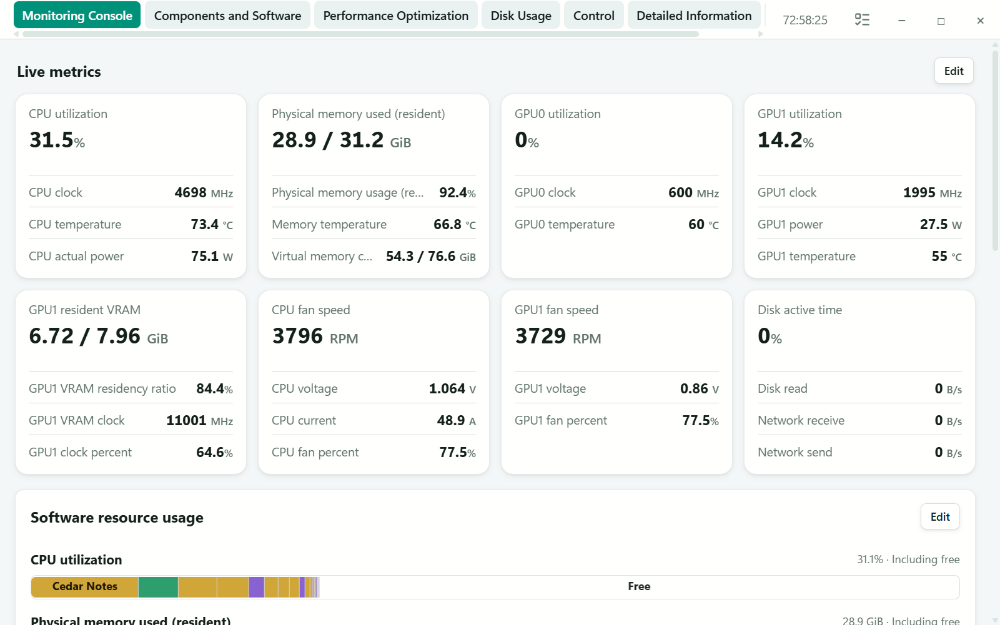

### 📈 Bar-chart overview

The lower half of the screenshot above uses bar charts so you can judge the state of your machine at a glance. Beyond the usual CPU, GPU, memory and VRAM views, you can also watch **virtual memory**. There are more monitoring items available here than the screenshot shows, and you can configure them freely.

### 🧮 Task-Manager-style view

This page is similar to the Windows Task Manager, except that you can inspect **many more monitoring items**. The layout and content follow Task Manager as closely as possible, and you can look at both application and process information — with lower overhead and smoother interaction.

It also fixes Task Manager's **double counting of shared memory**: the yellow part of each bar is the application's estimated share of shared memory. This is only meant to help you roughly analyze each application — nobody can divide shared memory between applications with perfect accuracy.

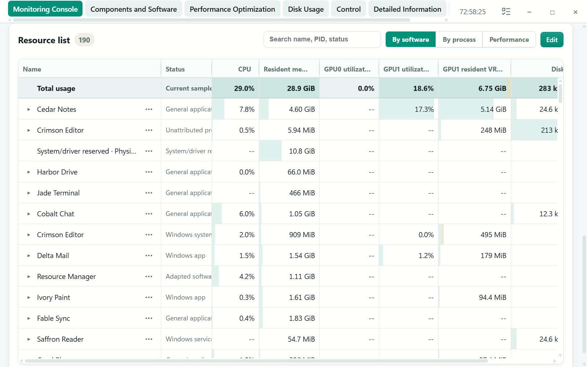

---

## 🧩 Components and Software

This page lists most of the software on your computer. If an application was not installed in the traditional way, you can add it manually by specifying its main executable and root directory so Resource Manager can bring it under management.

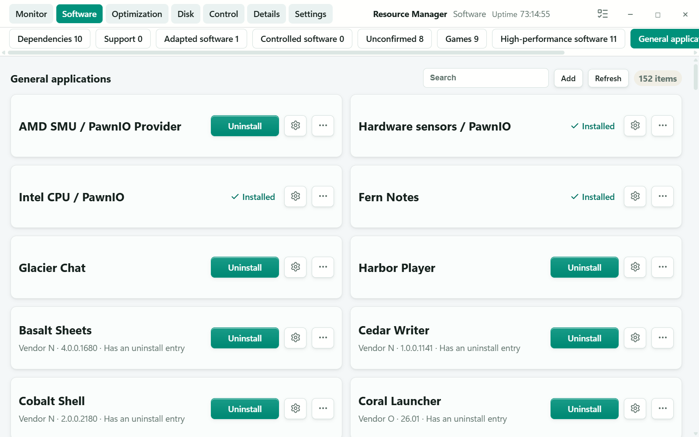

From here you can quickly:

- 📍 See where an application lives
- ⚙️ Configure optimization settings

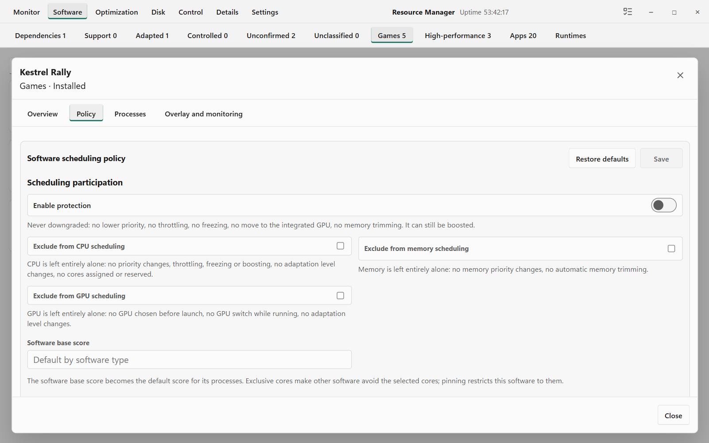

Each application can configure its base score, permitted adjustments, startup GPU preference and Level 2 protection. Runtime GPU placement is calculated after the process enters scheduling; it is not a saved target. Startup preferences do not override that calculation.

---

## ⚡ Performance Optimization

Choose **Normal**, or turn on **Memory**, **CPU**, and **GPU scheduling** independently. You can select any combination of the three; choosing Normal clears them all.

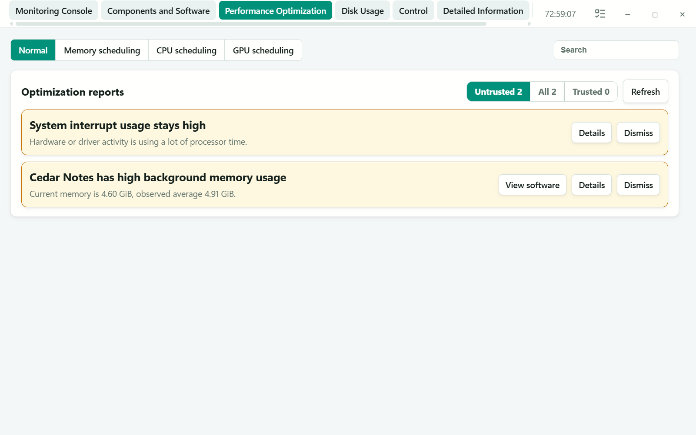

- **🧠 Memory scheduling** — manages RAM pressure without enabling CPU or GPU actions.
- **⚙️ CPU scheduling** — adjusts CPU policy and core placement.
- **⚡ GPU scheduling** — considers GPU load and VRAM pressure when placing supported renderers.

**VRAM and memory pressure.** GPU scheduling tracks GPU load and resident memory. When a lower-priority renderer has a verified runtime switching route, it can request a move to another GPU and check the next resident-memory sample. Unsupported renderers are not silently moved through a startup preference or an injected shim; even a supported move can leave some source-GPU residency.

**Multiple GPUs.** Per-application policies can select a launch GPU. Runtime moves are limited to renderer routes that pass their compatibility and cleanup checks; they are not general-purpose migration of every GPU-using application.

**Memory.** Selecting Memory scheduling enables ongoing RAM-pressure management. It can use CPU scores to order memory actions without enabling CPU actions.

**CPU.** When CPU scheduling is selected, cores are assigned intelligently: important applications get the less-contended or higher-performance cores first. You can also configure **exclusive core allocation** and **core locking** to help hold a stable frame rate.

> 💡 Worth noting: although Resource Manager uses highly optimized algorithms, scheduling still costs something. On CPUs with very weak multicore performance there may be no obvious CPU-side benefit — on a very early i3 or Ryzen 5, for example.

> 🧪 Runtime GPU switching currently uses an external controller without injecting a DLL into the target. A Chrome/ANGLE D3D11 route has been exercised with partial VRAM release; this does not verify native OpenGL switching. D3D12 and Vulkan have only been verified in a specific Qt fixture. This is not a claim of broad compatibility:
> - It is not applied to games or professional applications by default.
> - If another application has compatibility problems, turn scheduling off for that application.
> - Some motherboards and laptops disable the integrated GPU in discrete-GPU-direct mode. With only one available GPU, there is no cross-GPU move target; you can still enable GPU scheduling yourself.

### 📑 Optimization reports

Monitoring history is used to identify abnormal software, or software that is quietly stealing your PC's performance 🕵️:

- 💽 Abnormal disk writes
- 🌐 Unusually frequent network communication
- 📡 Excessive network traffic
- 🧠 Excessive memory usage
- 🔥 Excessive CPU usage
- ⚡ Frequent or long system interrupts
- …and other abnormal resource behavior

This helps you catch **memory leaks**, **misbehaving software**, **disk killers**, **problematic drivers**, and software that keeps talking to the network in the background.

> 📌 Abnormal network behavior points you at software worth investigating, but Resource Manager does not automatically decide that such communication is telemetry, nor infer what the transmitted data is for.

---

## 🎛️ Hardware Control

Balance performance, power and noise from one place. The control page brings together the CPU, GPU and fan adjustments available on your hardware, with live readings beside the controls so you can see the current state before changing it.

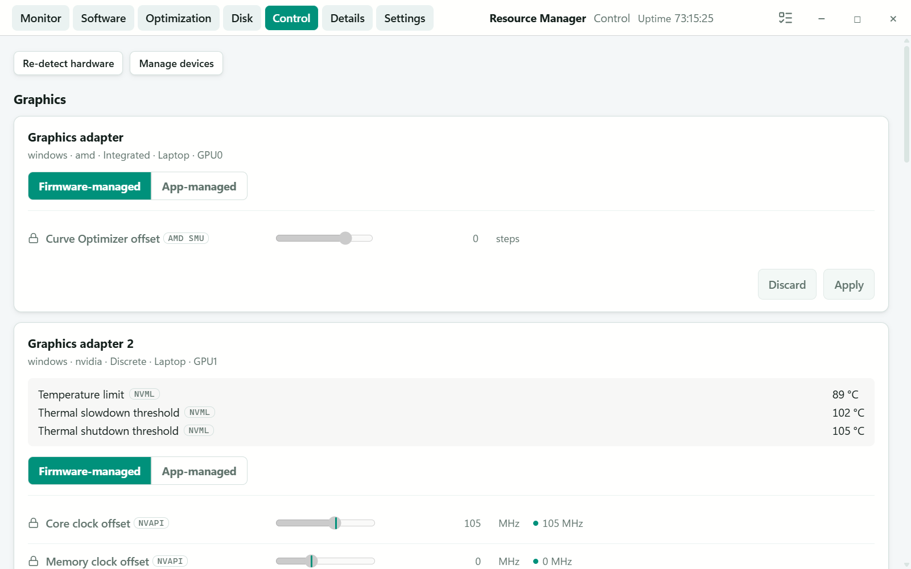

Each device has its own **Apply** and **Discard changes** buttons. Prepare several changes, apply just that device, or discard its draft without losing work on another card. Save settings as a profile to reuse them later. Controls that cannot be changed explain why when you hover over their icon; **Normal** and **Root** access levels distinguish ordinary adjustments from advanced controls.

The adjustment support matrix, with dependencies and hardware limitations, is in the [Support List](#-support-list).

### 🌡️ Fan curves

Choose the cooling response you want at each temperature. Drag a point or adjust it with the keyboard; neighboring points use **straight-line interpolation**, with a temperature and percentage grid for precise adjustments.

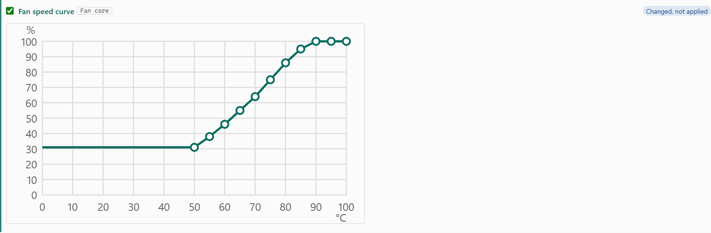

Where supported, choose between writing the curve to firmware and letting Resource Manager manage it in software. Editing stays in the card's draft until you apply it. You can also return a device to firmware control. Available settings, firmware curve steps and shared fan-control behavior depend on the hardware and driver.

---

## 🔌 Device Topology

Resource Manager displays every interface on the device — internal and external — along with its information and the devices connected to it.

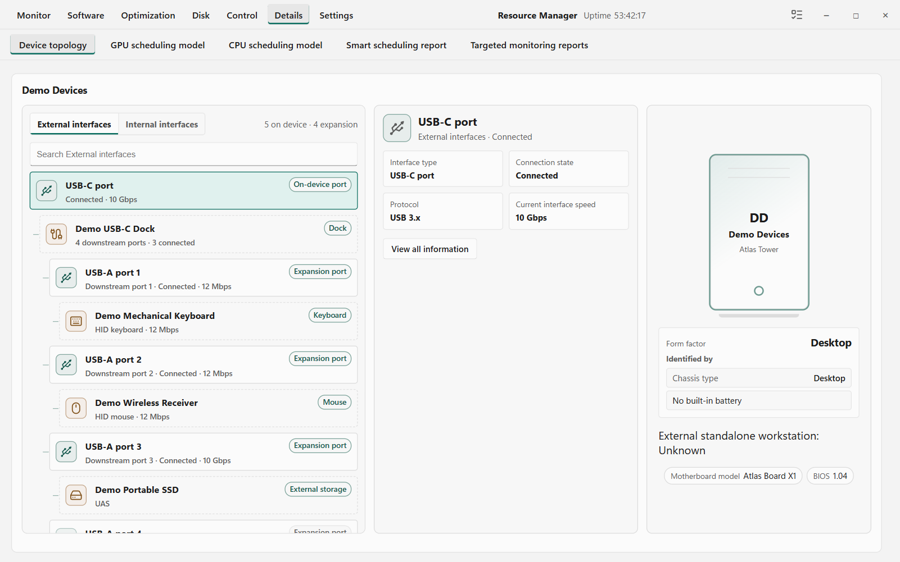

You can quickly check the **protocol that was actually negotiated**, which in many cases is the real limit on transfer speed.

---

## 🔬 Detailed Information

Detailed CPU and GPU monitoring, instead of a single utilization percentage that never tells you where the real bottleneck is.

**CPU topology**: per-core load laid out by CCD, cache level and physical core, with the processes using each logical processor.

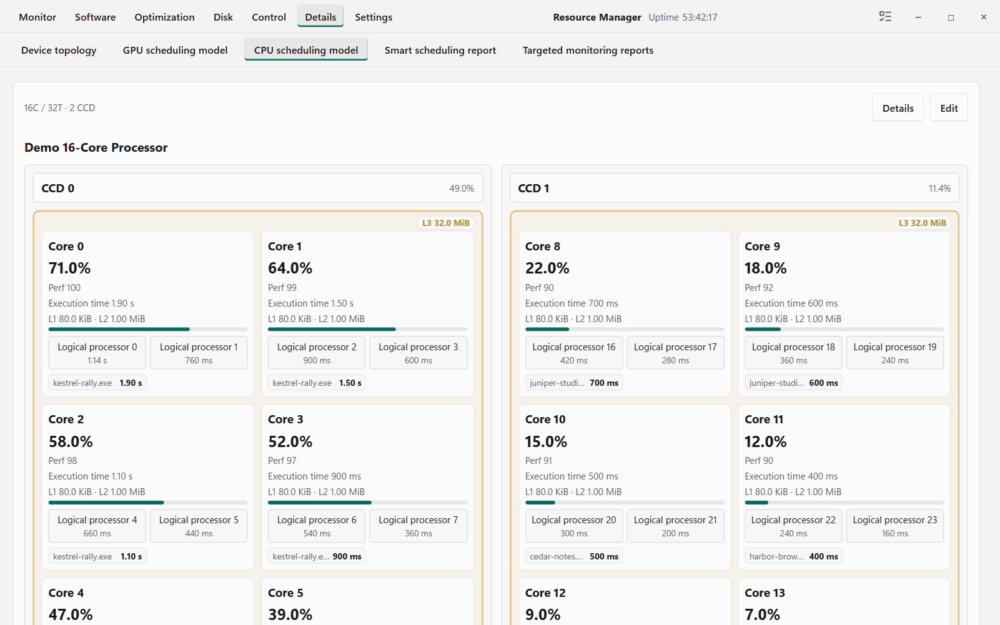

**GPU scheduling**: performance score, utilization, VRAM and clocks for each GPU, plus specialized-unit occupancy beyond rasterization (NVIDIA RT / CUDA / Tensor, AMD GCN / RDNA / CDNA — where the GPU and driver expose that counter).

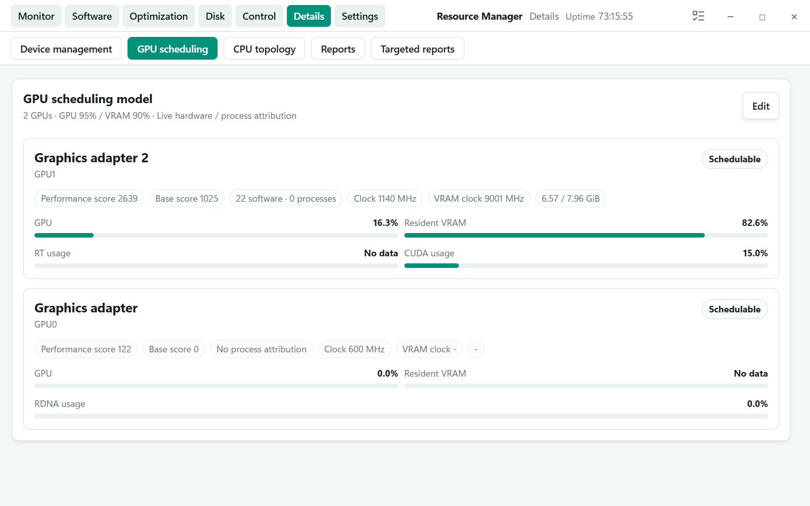

---

## 📋 Support List

✅ **Verified support** · 🟡 **Supported** · ❌ **Unsupported** · — not applicable

- **Hardware adjustment:** ✅ means writes and readback have been verified on a specific model. 🟡 means supported by design, with integration or physical testing still required. ❌ means excluded from the design.
- **Monitoring and device information:** ✅ means the reading returned current values on a real machine: an AMD Ryzen 9 8940HX laptop with an NVIDIA GeForce RTX 5060 Laptop GPU and AMD Radeon 610M integrated graphics, without an NPU, checked read-only on 2026-10-22. The values were not compared against other tools. 🟡 means implemented and tested with recorded or simulated data, but not yet confirmed on real hardware. ❌ means not supported.

This list describes the source code as of 2026-10-22. The latest published beta is 0.2.8 (2026-10-01); many of the readings below were added after it and arrive with the next beta. What your PC shows depends on its hardware, drivers and installed components. A reading that the hardware does not report is shown as unavailable.

### Hardware adjustment

This matrix describes the design scope of hardware adjustment. Available adjustments in the current release depend on the control page's capability detection.

<table>
  <thead>
    <tr><th rowspan="2" scope="col">Device type</th><th colspan="3" scope="colgroup">CPU</th><th colspan="3" scope="colgroup">GPU</th><th colspan="3" scope="colgroup">iGPU</th></tr>
    <tr><th align="center" scope="col">AMD</th><th align="center" scope="col">Intel</th><th align="center" scope="col">NVIDIA</th><th align="center" scope="col">AMD</th><th align="center" scope="col">Intel</th><th align="center" scope="col">NVIDIA</th><th align="center" scope="col">AMD</th><th align="center" scope="col">Intel</th><th align="center" scope="col">NVIDIA</th></tr>
  </thead>
  <tbody>
    <tr><th scope="row">💻 Laptop</th><td align="center" title="Supported">🟡</td><td align="center" title="Implemented; hardware validation pending">🟡</td><td align="center" title="Unsupported">❌</td><td align="center" title="AMD laptop discrete GPUs are excluded">❌</td><td align="center" title="Intel discrete GPUs are excluded">❌</td><td align="center" title="Supported">🟡</td><td align="center" title="Supported">🟡</td><td align="center" title="Supported">🟡</td><td align="center" title="Unsupported">❌</td></tr>
    <tr><th scope="row">🖥️ Desktop</th><td align="center" title="Supported">🟡</td><td align="center" title="Implemented; hardware validation pending">🟡</td><td align="center" title="Unsupported">❌</td><td align="center" title="Implemented; hardware validation pending">🟡</td><td align="center" title="Intel discrete GPUs are excluded">❌</td><td align="center" title="Supported">🟡</td><td align="center" title="Supported">🟡</td><td align="center" title="Supported">🟡</td><td align="center" title="Unsupported">❌</td></tr>
  </tbody>
</table>

GPU means discrete graphics; iGPU means integrated graphics.

<strong>View adjustments, dependencies and hardware limitations</strong>

**Adjustment scope and implementation status:**

The **0.2.7 stage release** connects **Intel CPU controls and AMD desktop GPU tuning** to the control page, dependency manager, readback and restore flow. Desktop motherboard fans use Fan Control Core's Super I/O backend. These changes have interface tests and are **not yet verified on physical hardware**. The 0.2.8 beta did not change the adjustment scope. In the current source, on / off controls offer three choices: return to firmware, on and off. The remaining design gaps are listed below.

- **AMD CPUs / APUs**: STAPM, slow and fast power limits, PBO Scalar and CPU Curve Optimizer. Hardware Bridge required; the processor, firmware and available driver determine each capability. Curve Optimizer requires readback. TDC / EDC current limits and temperature limit remain unavailable until mapping or readback is confirmed.
- **Intel CPUs**: PL1 / PL2, independent time windows and core / cache / iGPU / system-agent voltage offsets are implemented through the signed PawnIO IntelMSR module. Installation is explicit; firmware locks and OC mailbox errors are reported. **MMIO, TCC, Turbo ratios / switch, HWP / EPP and CPU / iGPU power balance remain incomplete**: the current signed modules do not permit their required registers. Installing the current component does not unlock these items.
- **AMD desktop discrete GPUs**: ADLX manual power offset (%), minimum core clock and maximum memory clock are implemented. Maximum core clock and core voltage use absolute values before Navi4, and offsets on identified Navi4 GPUs, as defined by ADLX. Unknown GPU generations cannot use these GFX controls until identified. Ranges and steps come from the driver; writes are read back, and removal restores the saved original parameter without resetting the whole GPU. **Legacy GFX / VRAM state-table tuning is not implemented**. **AMD laptop discrete GPUs are explicitly excluded** and must not enter a generic GPU fallback writer.
- **AMD integrated GPUs**: GPU Curve Optimizer, requiring Hardware Bridge and compatible SMU capabilities; separate from CPU Curve Optimizer.
- **Intel integrated GPUs**: Core frequency offset, requiring IGCL and hardware that exposes adjustment.
- **NVIDIA discrete GPUs**: NVAPI core and memory frequency offsets; NVML power limit, locked core and memory clocks and temperature thresholds. Ranges come from the driver. Some laptop drivers reject NVML writes; readable values do not imply writable controls.
- **Compatible Uniwill / Tongfang OEM laptops**: Additional cTGP offset and Dynamic Boost toggle and offset, requiring the matching EC interface. Register readback does not measure actual power changes.

**Fan adjustment:**

| Device type | Status | Scope |
| --- | --- | --- |
| 💻 Laptop | 🟡 | Compatible OEM channels: automatic / maximum speed, firmware curves, software curves and duty control. Fan Control Core required; each capability is detected separately |
| 🖥️ Desktop | 🟡 | Super I/O motherboard headers use Fan Control Core + LibreHardwareMonitor. AMD ADLX fan controllers expose minimum speed, target RPM and Zero RPM when supported. USB / HID controllers, NVIDIA native fan writing and AMD firmware fan curves remain incomplete |

Automatic / maximum-only channels do not offer arbitrary fixed speed. Requested RPM and monitored RPM are separate values. Remaining design gaps also include AMD CPU current / temperature readback and command mapping, advanced SMU controls and the Linux product control host; existing Linux hwmon support in Fan Control Core does not establish full Linux product support.

No complete physical validation record with model, driver, requested values and readback has been published yet, so none of these entries is labeled **✅ Verified support**. Please include those details and the result of restoring defaults when reporting hardware tests through Issues.

### Monitoring and readings

The monitoring console can show up to 325 named readings, grouped by device. The tables below group them by device type; the details list each group with its source.

<table>
  <thead>
    <tr><th scope="col">Device type</th><th align="center" scope="col">AMD</th><th align="center" scope="col">Intel</th><th align="center" scope="col">NVIDIA</th><th align="center" scope="col">Qualcomm</th></tr>
  </thead>
  <tbody>
    <tr><th scope="row">🧠 CPU</th><td align="center" title="Verified on Ryzen 9 8940HX: Windows counters and SMU readings">✅</td><td align="center" title="Implemented; hardware validation pending">🟡</td><td align="center" title="Unsupported: the release is Windows x64 only">❌</td><td align="center" title="Unsupported: the release is Windows x64 only">❌</td></tr>
    <tr><th scope="row">🎮 GPU</th><td align="center" title="Same ADLX path as the verified Radeon 610M; discrete GPUs not yet verified">🟡</td><td align="center" title="Implemented through IGCL; hardware validation pending">🟡</td><td align="center" title="Verified on GeForce RTX 5060 Laptop GPU: NVML, NVAPI and Windows counters">✅</td><td align="center" title="Not applicable">—</td></tr>
    <tr><th scope="row">🖼️ iGPU</th><td align="center" title="Verified on Radeon 610M: ADLX, SMU and Windows counters">✅</td><td align="center" title="Implemented through IGCL; hardware validation pending">🟡</td><td align="center" title="Unsupported: the release is Windows x64 only">❌</td><td align="center" title="Unsupported: the release is Windows x64 only">❌</td></tr>
    <tr><th scope="row">🤖 NPU</th><td align="center" title="Implemented; no NPU on the verification machine">🟡</td><td align="center" title="Implemented; no NPU on the verification machine">🟡</td><td align="center" title="Not applicable">—</td><td align="center" title="Unsupported: the release is Windows x64 only">❌</td></tr>
  </tbody>
</table>

A ✅ cell means the main readings of that column were verified on the machine named above; some readings inside it can still be 🟡, as listed in the details. AMD SMU readings depend on the processor generation, and only the Ryzen 9 8940HX has been checked.

| Device | Status | Main readings | Source |
| --- | :---: | --- | --- |
| 🧮 Memory and virtual memory | ✅ | Physical total / used / available; commit, limit and peak; system cache; kernel pools; process, thread and handle counts | Windows, built in |
| 🧩 NUMA nodes | ✅ | Available memory and capacity per node | Windows, built in |
| 💽 All disks | ✅ | Total active time, read / write rate, queue length | Windows performance counters |
| 💾 NVMe drives | 🟡 | Health status ✅; NVMe health log (temperatures, spare, wear, data read / written, errors, power-on time), reliability counters, per-disk throughput / IOPS / latency | Windows storage APIs |
| 💾 SATA drives | 🟡 | Health status, ATA SMART data and thresholds, reliability counters, per-disk throughput | Windows storage APIs |
| 💾 USB drives | 🟡 | Health status ✅; other readings depend on the USB bridge | Windows storage APIs |
| 🌐 Network | ✅ | Per interface: 17 cumulative counters and send / receive rate; total throughput and utilization | Windows IP Helper, performance counters |
| 🔋 Battery | ✅ | Charge, charge / discharge rate, power state, design / full-charge / remaining capacity, voltage, full-to-design ratio | Windows battery driver |
| 🌀 Laptop fans | ✅ | CPU and GPU fan speed (RPM and %) on compatible Uniwill / Tongfang laptops; other brands rely on LibreHardwareMonitor (🟡) | Built-in OEM reader, read-only |
| 🌀 Desktop fans and motherboard sensors | 🟡 | Fan speed, motherboard / VRM / chipset temperature, motherboard voltage, memory temperature, generic CPU temperature | LibreHardwareMonitor, optional |
| 📋 Applications and processes | ✅ | CPU, memory with estimated shared-memory share, disk, network, per-GPU usage and VRAM | Windows |

<strong>View readings, sources and limitations by device</strong>

**CPU**

| Readings | AMD | Intel | Source |
| --- | :---: | :---: | --- |
| Usage; frequency and percentage of base clock | ✅ | 🟡 | Windows counters, built in |
| Per-core and per-thread load on the CPU topology page | ✅ | 🟡 | Windows CPU Sets and processor information |
| Package, STAPM, actual and average power; SoC power and voltage; core voltage; package, TDC and EDC current; SMU temperature; average core clock | ✅ | — | AMD SMU through PawnIO and its RyzenSMU module (optional component, installed explicitly) |
| Core and package temperature (DTS), distance to TjMax, TjMax | — | 🟡 | Intel MSR through PawnIO and its IntelMSR module (optional component) |
| Energy counters for package, cores, graphics and DRAM; declared package and DRAM power limits | — | 🟡 | Intel MSR |
| Effective frequency per thread (average while active, from APERF / MPERF) | — | 🟡 | Intel MSR |
| Thermal, power, current and cross-domain limit status, current and logged | — | 🟡 | Intel MSR |
| Generic CPU temperature and desktop CPU fan | 🟡 | 🟡 | LibreHardwareMonitor (optional, WMI) |

The SMU temperature is the value the SMU reports; whether it is Tctl or Tdie is not established. Intel C-state residency and detailed throttle reasons are not available, because the current signed IntelMSR module does not permit those registers. Intel interval power is not provided yet; the raw energy counters are.

**GPU**

| Readings | NVIDIA | AMD | Intel | Source |
| --- | :---: | :---: | :---: | --- |
| Usage of the busiest engine | ✅ | ✅ | 🟡 | Windows GPU engine counters |
| Usage per engine | 🟡 | 🟡 | 🟡 | Windows GPU engine counters |
| Vendor utilization: processor, memory controller, encoder, decoder (NVML); activity (ADLX); render / compute and media busy (IGCL) | ✅ | ✅ | 🟡 | NVML; ADLX; IGCL |
| Core clock, memory clock, clock percentage | ✅ | ✅ | 🟡 | NVML; ADLX and SMU; IGCL |
| Video memory: used, total, free, reserved | ✅ | 🟡 | — | NVML; ADLX |
| Power and limits: reported, instant and 1-second average power, default and enforced limit (NVML); chip and board power (ADLX); interval power and energy (IGCL) | ✅ | 🟡 | 🟡 | NVML; ADLX; IGCL |
| Core / edge / APU temperature | ✅ | ✅ | 🟡 | NVML; ADLX and SMU; IGCL |
| Memory, hotspot and intake temperature | 🟡 | 🟡 | 🟡 | NVML; ADLX; IGCL |
| Voltage | ✅ | ✅ | 🟡 | NVAPI; ADLX and SMU; IGCL |
| Current | 🟡 | — | — | NVAPI |
| PCIe link generation and width, current and maximum | ✅ | — | 🟡 | NVML; IGCL |
| Performance state and clock-event reasons (NVML); power / temperature / current / voltage / utilization limit flags (IGCL) | ✅ | — | 🟡 | NVML; IGCL |
| Fan speed reported by the GPU | 🟡 | 🟡 | 🟡 | NVML (per fan); ADLX; IGCL |
| Memory read / write traffic counters | — | — | 🟡 | IGCL |

The AMD column was checked on the Radeon 610M integrated GPU; AMD discrete GPUs use the same ADLX path but have not been checked. The test GPUs do not report memory temperature or current. Laptop GPU fans are covered under laptop fans.

**NPU**

| Readings | Intel | AMD | Qualcomm | Source |
| --- | :---: | :---: | :---: | --- |
| Name, driver and location | 🟡 | 🟡 | ❌ | DXCore, Windows device tree |
| Dedicated and shared memory, committed and resident | 🟡 | 🟡 | ❌ | DXCore |
| Engine running time and busy percentage (same algorithm as Task Manager; can exceed 100%) | 🟡 | 🟡 | ❌ | DXCore |
| Activity and frequency reported by AMD, shown under the AMD GPU | — | 🟡 | — | ADLX |

The verification machine has no NPU. Qualcomm NPUs run on Windows on Arm, which the x64 release does not support.

**Memory, storage, network, battery and fans**

| Readings | Status | Source |
| --- | :---: | --- |
| Physical memory, commit, system cache, kernel pools; process / thread / handle counts | ✅ | Windows |
| NUMA node available memory and capacity, single node | ✅ | Windows |
| NUMA with several nodes or memory-only nodes | 🟡 | Windows |
| Memory temperature | 🟡 | LibreHardwareMonitor |
| Total disk active time, read / write rate, queue length | ✅ | Windows performance counters |
| Drive health status, NVMe and USB | ✅ | Windows storage management (MSFT_PhysicalDisk) |
| Drive health status, SATA | 🟡 | Windows storage management (MSFT_PhysicalDisk) |
| Drive temperature, wear, read / write errors, power-on hours, start-stop and load cycles, maximum latencies | 🟡 | Windows storage reliability counters |
| NVMe health log: warnings, spare, percentage used, composite and eight sensor temperatures, data units, commands, busy time, power cycles, unsafe shutdowns, media errors, raw 512-byte log | 🟡 | NVMe health log query |
| ATA SMART data and thresholds (raw pages) | 🟡 | ATA SMART query |
| Per-disk read / write rate, IOPS, active time, queue length, latency | 🟡 | Windows disk performance query |
| Network per interface: bytes, unicast / multicast / broadcast traffic, packets, discards, errors, unknown-protocol packets, send / receive rate | ✅ | Windows IP Helper |
| Network total send / receive rate and utilization | ✅ | Windows performance counters |
| Battery charge, rate, power state, capacities, voltage, full-to-design ratio | ✅ | Windows battery driver |
| Battery cycle count and remaining time | 🟡 | Windows battery driver; depends on the battery firmware |
| Laptop CPU / GPU fan speed, compatible Uniwill / Tongfang laptops | ✅ | Built-in OEM reader (UWACPI, read-only) |
| Desktop fans, motherboard / VRM / chipset temperature, motherboard voltage | 🟡 | LibreHardwareMonitor (optional, WMI) |
| Per-application and per-process CPU, memory, disk, network, GPU usage and VRAM | ✅ | Windows process counters, ETW, GPU counters |

### Device information

| Area | Status | Contents |
| --- | :---: | --- |
| 🔌 Device topology | ✅ | Internal and external ports, connected devices, negotiated and maximum link speed |
| 🔗 USB, HID and cameras | ✅ | USB identity and speed, HID collections, declared UVC camera frame intervals |
| 🖥️ Displays and EDID basics | ✅ | Current mode, HDR state, luminance, rotation; raw EDID, version, size and chromaticity |
| 📐 Display modes and timings | 🟡 | Modes parsed from EDID, CTA-861 and DisplayID 1.3 / 2.x, including Type V / VI timings and Adaptive-Sync |
| 🧠 CPU identity and topology | ✅ | CPUID identity, instruction features, cores, threads, CCDs and caches |
| 🎮 GPU identity | ✅ | Name, PCI IDs, driver version, VBIOS; NVIDIA CUDA capability; AMD VRAM type |
| 🧰 GPU API capabilities | 🟡 | Vulkan, OpenGL, Direct3D and OpenCL limits and features |
| 🧾 SMBIOS and firmware | ✅ | System, baseboard, BIOS, memory modules, slots and CPU socket |
| 💾 Disks and volumes | ✅ | Partition layout, alignment, TRIM, volume space, page files |
| 🌐 Network, security and drivers | ✅ | Addresses, routes, TCP / UDP endpoints, security products, driver versions |
| 🤖 NPU identity | 🟡 | Name, driver and location |

<strong>View device information details and sources</strong>

| Area | Status | Contents | Source |
| --- | :---: | --- | --- |
| Device topology | ✅ | USB, PCIe, HD Audio, eDP, HDMI, Mini DP, RJ45 and Bluetooth ports with the devices behind them, and the USB-C connector manager (UCSI); negotiated and maximum speed | Windows device tree (SetupAPI / CfgMgr32) |
| USB | ✅ | VID / PID, class, USB version, device version, serial number, connector type, parent hub port, current and maximum speed | USB hub queries |
| USB cameras (UVC) | ✅ | Declared frame intervals per format and resolution (Uncompressed / MJPEG) and best mode; the current stream mode is 🟡 | USB descriptors |
| HID | ✅ | Top-level collections, usage, report lengths, button and value capabilities | Windows HID API |
| PCI | ✅ | Vendor / device / subsystem / revision IDs, hardware and compatible IDs, assigned memory / IO / bus ranges, interrupts; legacy DMA channels are 🟡 | Windows device tree |
| Displays | ✅ | Resolution, exact refresh ratio and bit depth of the current mode; HDR support / enabled / active; color mode, SDR white level, luminance, rotation | DisplayConfig, DXGI |
| EDID basics | ✅ | Raw EDID stored by Windows, EDID version, product name, physical size, base chromaticity | Registry EDID |
| Display modes and timings | 🟡 | Detailed, standard and established timings, CVT, range limits; CTA-861 video formats, YCbCr 4:2:0, color and HDR declarations; DisplayID 1.3 timings (Type I, II, III, V, VI) and DisplayID 2.x timings (Type VII), dynamic timing ranges, Adaptive-Sync. A declaration the parser does not recognize makes the mode list unavailable instead of guessed | Registry EDID |
| CPU | ✅ | CPUID vendor / family / model / stepping / brand, instruction features and OS-usable features; cores, threads, CCDs, caches, efficiency class | CPUID, Windows processor information |
| CPU, extended | 🟡 | XSAVE state masks, address widths, virtualization (VMX / SMX / SVM), per-thread CPUID registers, package and die relations, Intel specification clocks | CPUID, Windows |
| GPU identity | ✅ | Name, PCI IDs, adapter LUID, driver version; NVIDIA VBIOS and CUDA compute capability; AMD VBIOS version, part number and date, VRAM type | DXGI, NVML, ADLX |
| GPU API capabilities | 🟡 | Vulkan core and image limits, OpenGL, Direct3D 11 video, Direct3D 12 raytracing tier, OpenCL | Graphics APIs |
| NVIDIA driver profiles | 🟡 | Driver profile settings, read-only | NVAPI |
| SMBIOS | ✅ | System, baseboard and BIOS; memory modules (Type 17), slots (Type 9), CPU socket (Type 4) | Firmware tables |
| ACPI tables | 🟡 | Raw ACPI tables, read on demand | Firmware tables |
| Disks and volumes | ✅ | Partition layout (MBR / GPT), alignment, TRIM, bus type, volume space and quotas, page files; ATA / NVMe Identify data is 🟡 | Windows storage APIs |
| Network configuration | ✅ | Interface IDs, IPv4 / IPv6 addresses, routes, TCP / UDP endpoints with the owning process | Windows IP Helper |
| Security products | ✅ | Antivirus and firewall products and their health, active firewall profiles | Windows Security Center, firewall API |
| Drivers | ✅ | Provider, date and version per device | Windows device tree |
| Battery identity | ✅ | Manufacturer, chemistry, serial number | Windows battery driver |
| NPU identity | 🟡 | Name, driver and location | DXCore, Windows device tree |

### Optimization: real-machine results

Tested once on 2026-10-22 with a development build on the verification machine above (Ryzen 9 8940HX, 2 CCDs, 32 GB). Other build workloads ran at the same time, so swings in system-wide available memory came from them and are not counted as an optimization effect. The table only lists actions and restores that were observed directly.

| Item | Status | Observed |
| --- | :---: | --- |
| Memory scheduling: trimming idle background processes | ✅ | 8 low-usage background processes trimmed in 12 minutes, about 430 MB in total; truly idle processes stay low |
| Memory scheduling: lowering background memory priority | 🟡 | 92 processes written within 30 seconds of switching to memory scheduling, all restored when switching back to normal or stopping; entering it directly at cold start applies too few, being corrected in source |
| CPU scheduling: single-CCD placement | 🟡 | Places processes on one CCD on a 2-CCD machine; a failure to undo placements is fixed in source and awaits a retest |
| GPU scheduling | — | Not tested; it involves launch interception and a D3D proxy |

After the test, every process's priority, affinity, memory priority, throttling state and CPU Sets matched the state before the test.

---

## ⚙️ Settings

Configure the scheduling policies you want.

Appearance offers an interface style and a palette. A style changes the corners, lines, shadows and fonts of controls without changing the layout: Standard (System, Light, Dark, Low contrast), Soft (System, Light, Dark), Outline (System, Paper, Graphite, Blueprint) and Terminal (Phosphor, Amber, Ice). Each style lists only its own palettes.

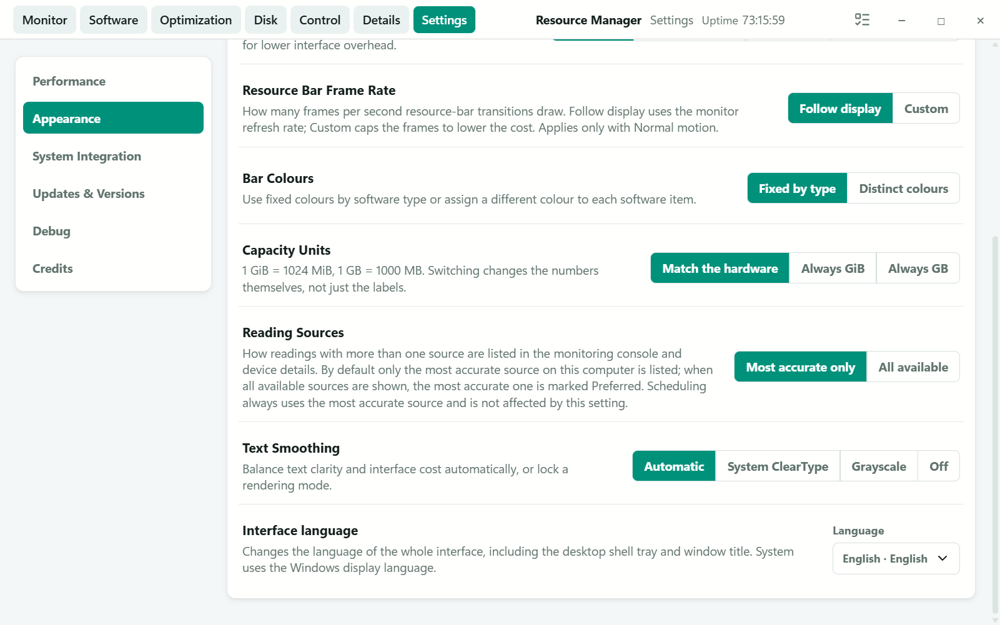

---

## 🧑‍💻 Developer API

Efficient resource management takes cooperation 🤝.

Local APIs and the adapter SDK let you connect your own monitoring and management tools. The developer API documentation is still being prepared.

---

## ⬇️ Download

Get the Windows x64 beta from GitHub Releases:

**[👉 Download the latest release](https://github.com/BIOcanse/Resource-Manager/releases/latest)**

### Requirements

- Windows 11 x64
- Microsoft Edge WebView2 Runtime

The release package includes the required .NET runtime. It uses your system's WebView2 runtime; if WebView2 is missing, the official Microsoft runtime is downloaded and installed on first startup. Checking for and downloading product updates also requires an internet connection; normal use does not.

---

## 📦 Installation

1. Download the latest Windows x64 release archive.
2. Extract the **complete folder** to a temporary location.
3. Run `Install.exe`, review its list of installation actions, and approve. It installs the main program and an independent update manager in `Internal/Management` inside the main program root, then registers the service, system paths, and Start menu shortcuts. If an owned previous installation is detected, the confirmation lists stopping it, removing its startup and system registration, copying user data, and registering the new installation. The previous program and original data are preserved.
4. Find **Resource Manager** in the Start menu or run the installed `Start.exe` to start the service and desktop interface. You can pin the Start menu entry to the taskbar.
5. For updates, interrupted update recovery, or main program repair, open **Resource Manager 更新管理** from the Start menu. Manual update and repair require a complete extracted release folder. The manager shows its actions before requesting administrator permission.
Service management requests administrator permission; the interface runs as a standard user.

`Install.exe` only installs or reinstalls, and `Start.exe` only starts the product. Reinstallation copies `Config`, `UserData`, and `Misc` into a new root; an occupied default root uses a versioned directory. Previous maintenance files remain in the old root; legacy external entry files are preserved under `Internal` there. The independent update manager still provides updates in the existing directory and same-version repair. The automatic update switch currently saves a preference; automatic installation awaits release signing and real-machine upgrade validation.

Use `UninstallResourceManager.exe` to uninstall. Keeping user data leaves only one importable ZIP in the old installation folder and opens that folder in File Explorer. The independent update manager can import the ZIP. If you reinstall into that folder, the retained ZIP is saved under `UserData/Archives` until you choose to import it.

---

## 📄 License and Acknowledgements

Resource Manager is licensed under the **[Apache License 2.0](LICENSE)**. Third-party components retain their own licenses.

This project would not be possible without the work of Microsoft, the .NET Foundation, and the many upstream authors and maintainers behind its dependencies. We are deeply grateful for their work 🙏. Full acknowledgements and license information are available in the application's Credits page and in the [Third-Party Notices](src/Core/ThirdPartyNotices/README.md).

---

## 🗂️ Repository

This project is maintained by the author. **External contributions and pull requests are not accepted.**

https://github.com/BIOcanse/Resource-Manager
