

# 🖥️ Resource Manager

**See every resource in your PC — and decide who gets it.**

**English** · [简体中文](README.zh-CN.md)

---

## 📖 What it is

Resource Manager shows how your PC uses its CPU, GPU, memory, video memory, disks and network, and lets you decide which programs come first.

It is free and open source.

> ⚠️ What you can see and adjust depends on your hardware and drivers. A reading your hardware does not provide is shown as unavailable.

> 🖼️ Screenshots use an invented machine.

---

## 📊 Monitor

The console puts the readings you care about on cards and bars. You choose what each card shows and how it is laid out.

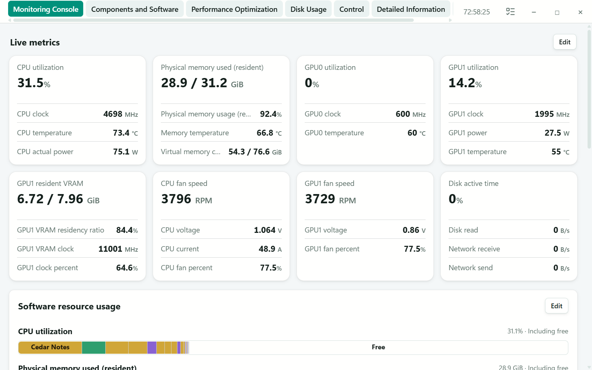

Many readings have more than one source. Pick one, or leave it on **Automatic** to use the most accurate source on your PC.

The resource bars show usage at a glance, including virtual memory. When a bar has no reading, it says why.

### 🧮 Processes

This view works like Task Manager, with many more columns and lower overhead.

Shared memory is not counted twice. The dashed part of each memory bar is the program's estimated share of shared memory.

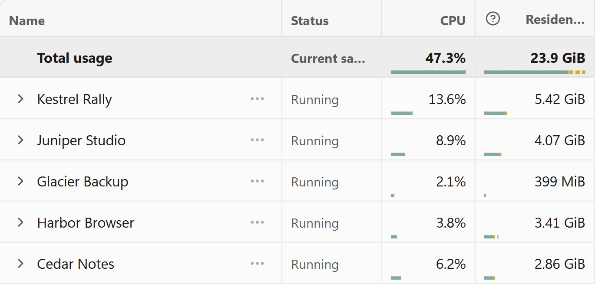

Memory the system and drivers keep for themselves appears as its own row, broken down into its parts.

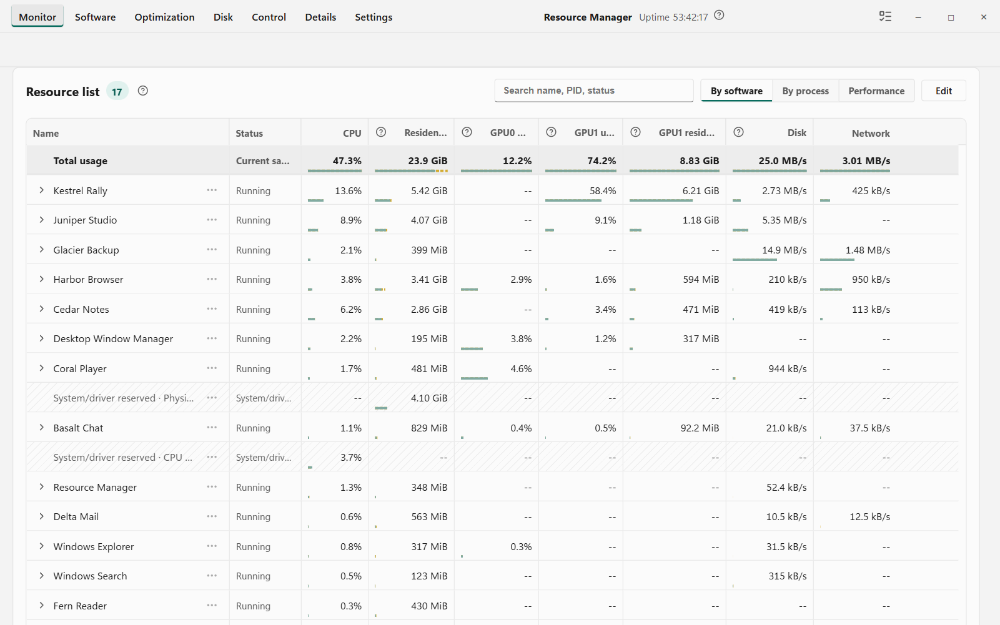

---

## 🧩 Software

Find the programs on your PC and where they are installed. A program that was not installed the usual way can be added by hand.

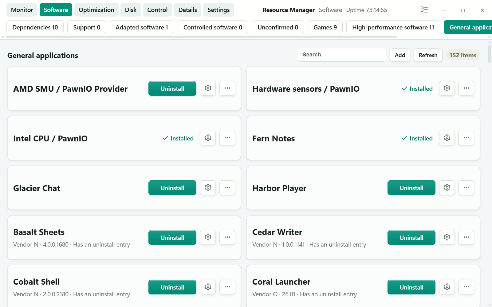

Each program has its own policy: base score, allowed adjustments, preferred GPU at launch, and protection level.

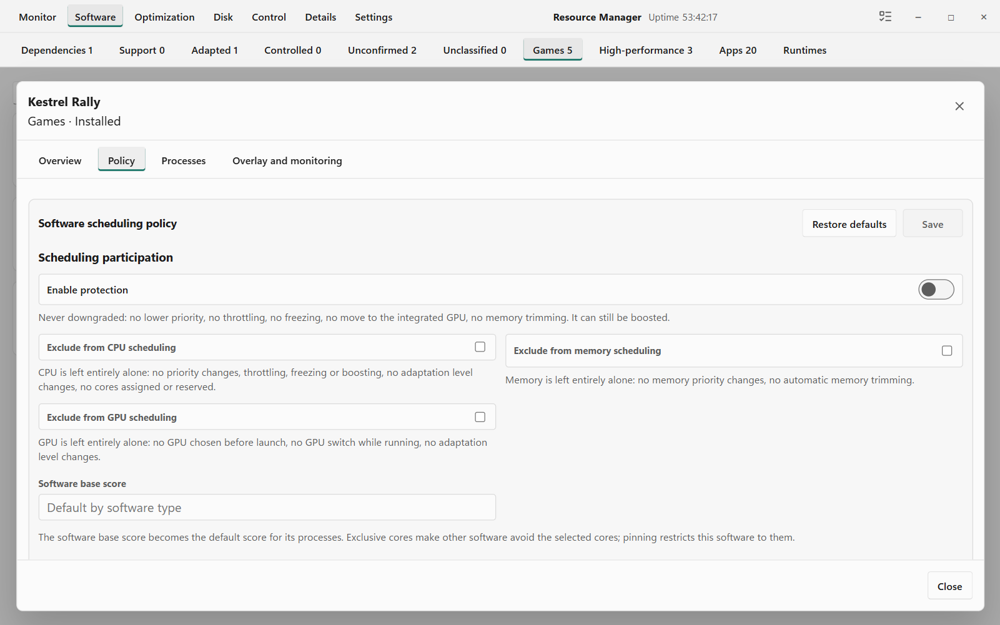

Optional components, such as the sensor driver, are installed only when you ask. Without them, their readings show as unavailable and everything else keeps working.

---

## ⚡ Optimization

Turn on **Memory**, **CPU** and **GPU** scheduling separately, in any combination. **Normal** turns them all off.

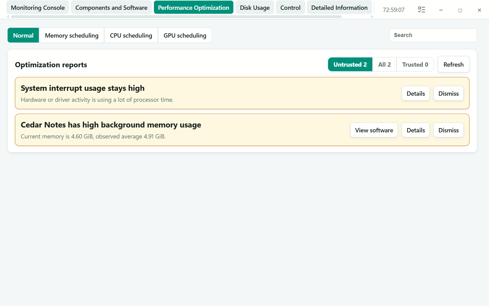

- **🧠 Memory** relieves memory pressure.
- **⚙️ CPU** gives higher-scored programs the faster, less busy cores. No program is locked out of any core unless you ask for it.
- **⚡ GPU** watches GPU load and video memory, and can move programs between any of your GPUs. On most PCs that means moving background programs to the integrated GPU.

Moving a running program to another GPU works only for programs that support it. Games and professional software are left alone by default.

> 💡 Scheduling has a small cost of its own. On CPUs with few, slow cores, the benefit may be small.

### 📑 Reports

Resource Manager watches for programs that misbehave:

- 💽 Unusual disk writes
- 🌐 Frequent or heavy network traffic
- 🧠 High memory use or leaks
- 🔥 High CPU use
- ⚡ Long or frequent system interrupts

Unusual network traffic is a hint worth checking, not proof of anything.

---

## 💽 Disk Usage

Find out what fills your disks. Files and folders are drawn as blocks sized by the space they take; open a block to go deeper.

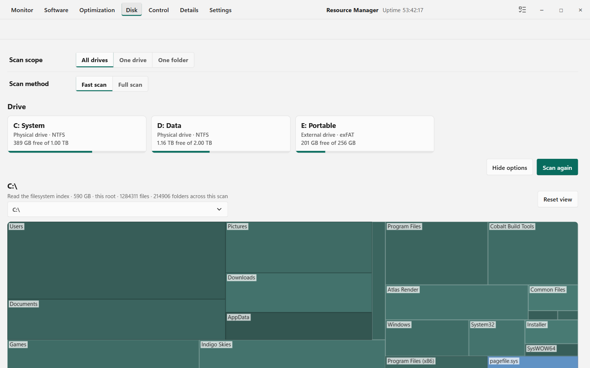

Scan all disks, one disk, or one folder. **Fast scan** needs administrator rights; **Full scan** works anywhere. Scanning only reads; it never changes or deletes files.

---

## 🎛️ Hardware Control

Balance performance, power and noise in one place. Live readings sit beside each control.

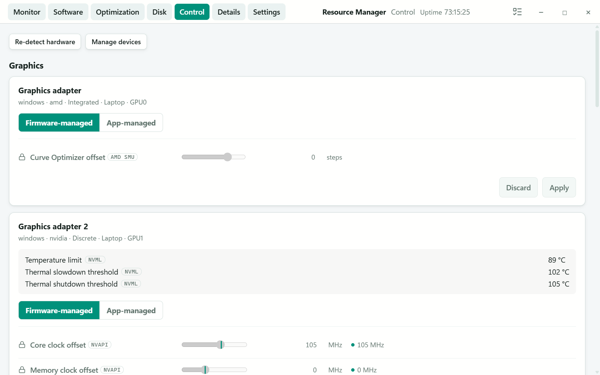

Each device card has its own **Apply** and **Discard**. Save settings as a profile to use again. A control you cannot change tells you why.

See [Hardware support](#-hardware-support) for what your hardware allows.

### 🌡️ Fan curves

Set the fan speed for each temperature by dragging points on the curve.

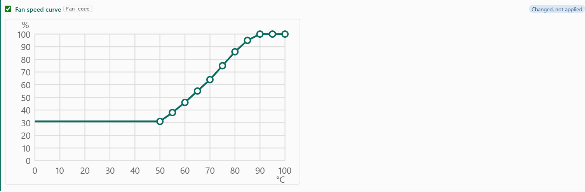

Depending on the hardware, a fan can be left to the firmware, have your curve written into the firmware, or be driven by Resource Manager while it runs.

---

## 🔌 Device Topology

See every port on your PC, inside and out, and what is connected to each.

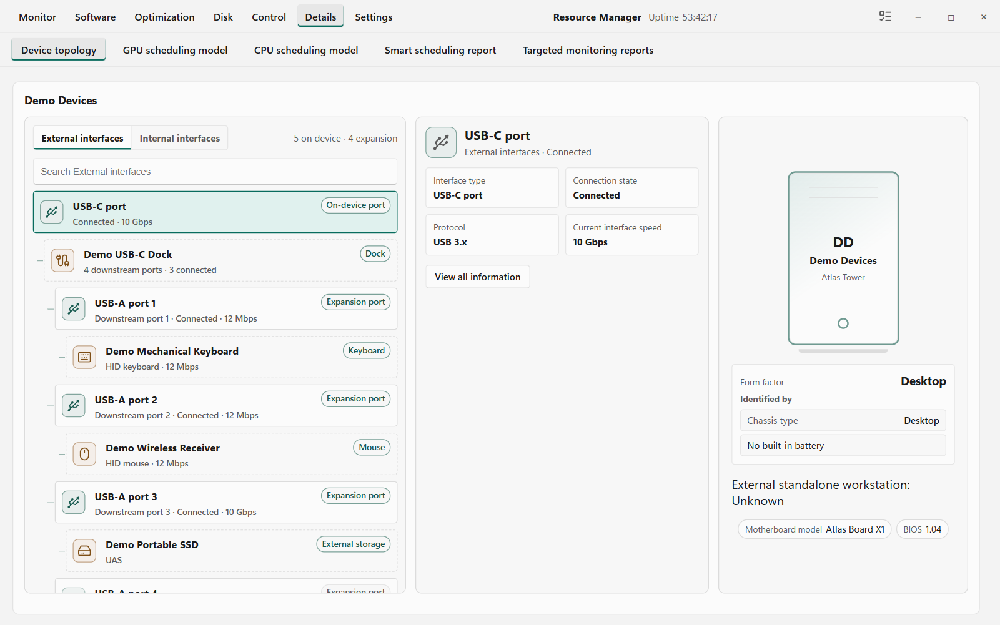

It shows the speed a link actually negotiated, which is often the real limit.

---

## 🔬 Details

**CPU topology** shows the load on every core and thread, and which programs use them.

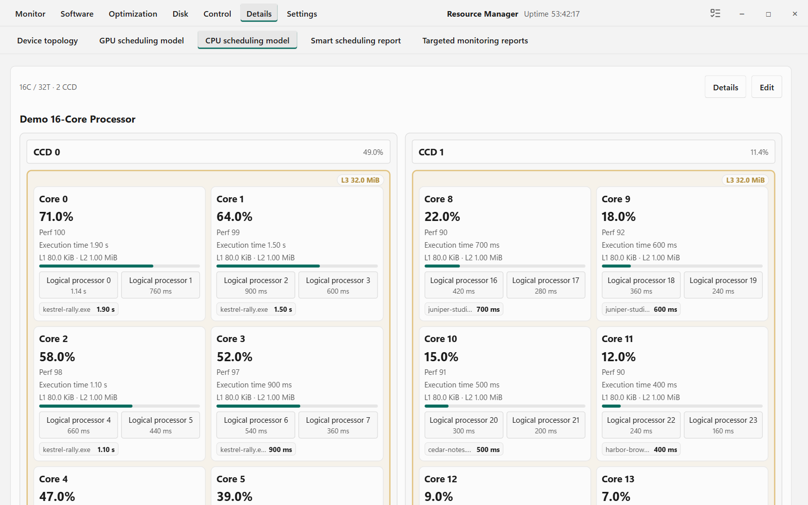

**GPU view** shows each GPU's load, video memory, clocks and specialized units.

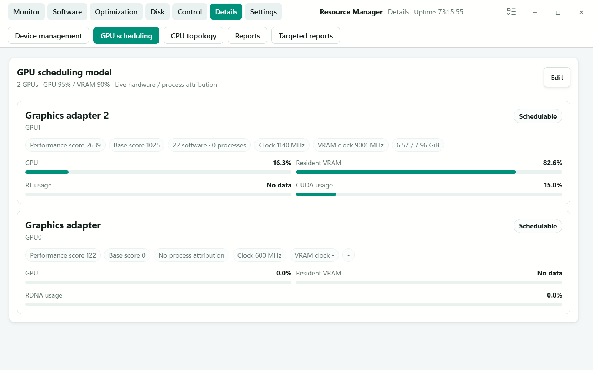

**Recordings** capture one running program's frame times and resource use, and export them as JSON or CSV.

---

## ⚙️ Settings

Choose scheduling behavior, look and feel, update mode and access keys.

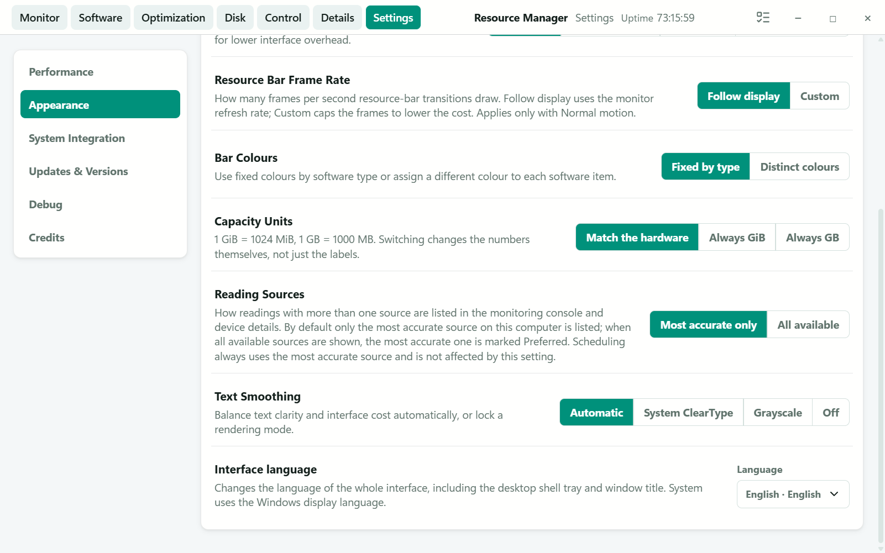

- **Appearance:** several styles and palettes, light and dark themes, and three motion styles.
- **Updates:** off, notify only, or download and apply automatically.
- **Access keys:** let a local program use Resource Manager, with only the permissions you grant. Revoke a key at any time.

---

## 🧑‍💻 Developer API

Local programs can read data and request actions through the local API and the adapter SDK. Each program needs an access key you approve.

---

## 📋 Hardware Support

✅ Tested on real hardware · 🟡 Implemented, not yet tested on real hardware · ❌ Not supported · — Not applicable

### Adjustment

<table>
  <thead>
    <tr><th rowspan="2" scope="col">Device</th><th colspan="3" scope="colgroup">CPU</th><th colspan="3" scope="colgroup">Discrete GPU</th><th colspan="3" scope="colgroup">Integrated GPU</th></tr>
    <tr><th scope="col">AMD</th><th scope="col">Intel</th><th scope="col">NVIDIA</th><th scope="col">AMD</th><th scope="col">Intel</th><th scope="col">NVIDIA</th><th scope="col">AMD</th><th scope="col">Intel</th><th scope="col">NVIDIA</th></tr>
  </thead>
  <tbody>
    <tr><th scope="row">💻 Laptop</th><td align="center">✅</td><td align="center">🟡</td><td align="center">❌</td><td align="center">❌</td><td align="center">❌</td><td align="center">✅</td><td align="center">✅</td><td align="center">🟡</td><td align="center">❌</td></tr>
    <tr><th scope="row">🖥️ Desktop</th><td align="center">🟡</td><td align="center">🟡</td><td align="center">❌</td><td align="center">🟡</td><td align="center">❌</td><td align="center">🟡</td><td align="center">🟡</td><td align="center">🟡</td><td align="center">❌</td></tr>
  </tbody>
</table>

- **AMD CPUs:** power limits, PBO scalar, Curve Optimizer.
- **Intel CPUs:** PL1 / PL2 with their time windows, voltage offsets.
- **AMD discrete GPUs:** power, core clock, memory clock and voltage, within the driver's ranges.
- **AMD integrated GPUs:** Curve Optimizer.
- **Intel integrated GPUs:** core clock offset.
- **NVIDIA GPUs:** clock offsets, power limit, locked clocks, temperature limit. Some laptop drivers refuse changes.
- **Compatible Uniwill and Tongfang laptops:** GPU power offset and Dynamic Boost.

> 🔒 Low-level access uses the signed PawnIO driver, which works with Memory Integrity and Secure Boot. Drivers with known vulnerabilities are never used.

### Fans

| Device | Status | What you can do |
| --- | :---: | --- |
| 💻 Laptop | ✅ Uniwill / Tongfang · 🟡 ASUS, HP OMEN / Victus, Lenovo Legion, Acer Predator / Nitro | Automatic or full speed, firmware curves, software curves, as far as each model's firmware allows |
| 🖥️ Desktop | 🟡 | Motherboard fan headers; minimum speed and target RPM on AMD graphics cards |

### Monitoring

| Device | Status | What you can see |
| --- | :---: | --- |
| 🧠 CPU | ✅ AMD · 🟡 Intel | Load per core and thread, clocks, power, voltage, temperature |
| 🎮 Discrete GPU | ✅ NVIDIA · 🟡 AMD | Load, video memory, clocks, power, temperature, fans |
| 🖼️ Integrated GPU | ✅ AMD · 🟡 Intel | Load, shared memory, clocks, power, temperature |
| 🤖 NPU | 🟡 | Load and memory |
| 🧮 Memory | ✅ | Physical and virtual memory, cache, kernel pools |
| 💽 Disks | ✅ | Activity, read and write speed, queue |
| 💾 NVMe and SATA drives | ✅ NVMe · 🟡 SATA | Health, temperature, wear, data written |
| 🌐 Network | ✅ | Speed and traffic per adapter |
| 🔋 Battery | ✅ | Charge, rate, capacity, wear |
| 🌀 Desktop fans and sensors | 🟡 | Fan speed, motherboard temperatures and voltages |
| 📋 Programs | ✅ | CPU, memory, disk, network and GPU use per program |

### Device information

| Area | Status | What you can see |
| --- | :---: | --- |
| 🔌 Ports and connected devices | ✅ | Every port, what is connected, negotiated speed |
| 🔗 USB, HID and cameras | ✅ | Device identity and speed, camera modes |
| 🖥️ Displays | ✅ | Current mode, HDR, refresh rate, EDID |
| 🧠 CPU and GPU | ✅ | Model, features, cores, caches, driver |
| 🧾 Motherboard and firmware | ✅ | System, board, BIOS, memory modules |
| 💽 Disks and volumes | ✅ | Partitions, space, TRIM |
| 🌐 Network and security | ✅ | Addresses, connections per program, antivirus and firewall |

---

## ⬇️ Download

**[👉 Download the latest release](https://github.com/BIOcanse/Resource-Manager/releases/latest)**

### Requirements

- Windows 11 x64
- Microsoft Edge WebView2 Runtime. If it is missing, Resource Manager offers to install it the first time it starts.

---

## 📦 Installation

1. Download the release archive and extract the whole folder.
2. Run `Install.exe`. It lists what it will do and asks before it starts.
3. Open **Resource Manager** from the Start menu.

To update or repair, open the update manager from the Start menu.

To uninstall, run `UninstallResourceManager.exe`. You can keep your data as one file and import it later.

---

## 📄 License

Resource Manager is licensed under the [Apache License 2.0](LICENSE). Third-party components keep their own licenses; the full list is on the Credits page in the app.

Thanks to the authors of the open-source projects it builds on 🙏.

---

## 🗂️ Repository

Maintained by the author. Pull requests are not accepted.
