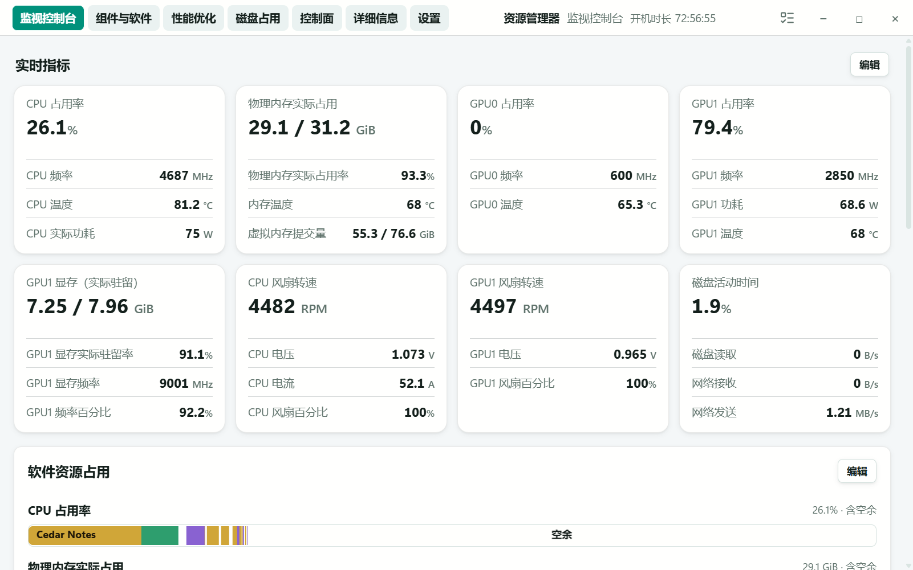
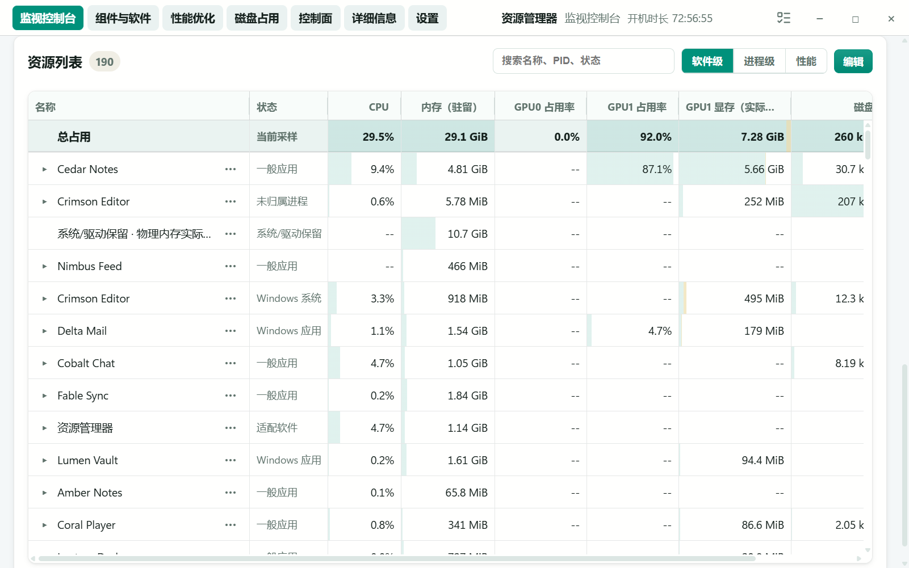
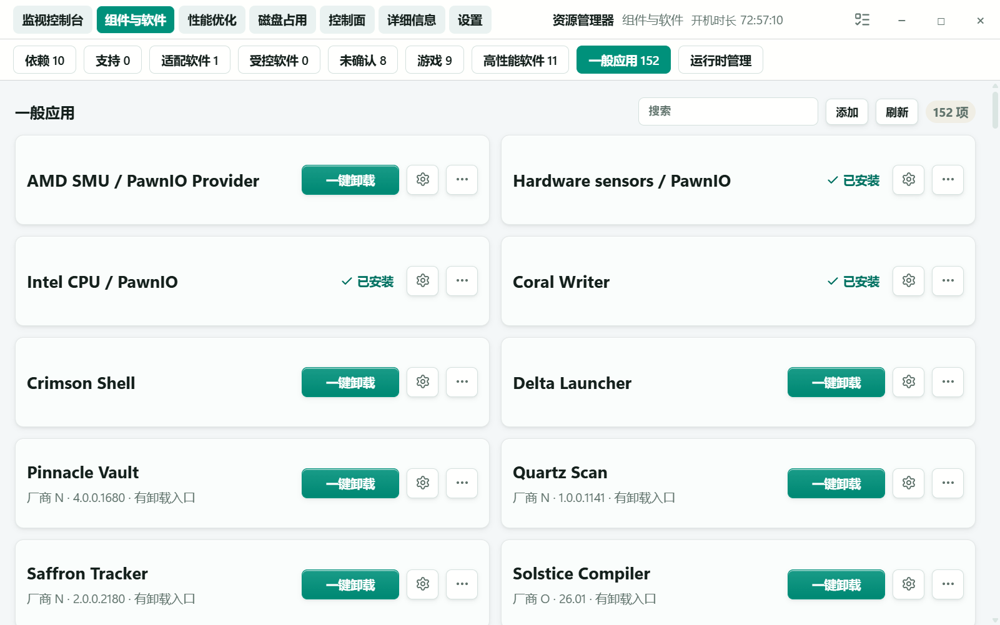
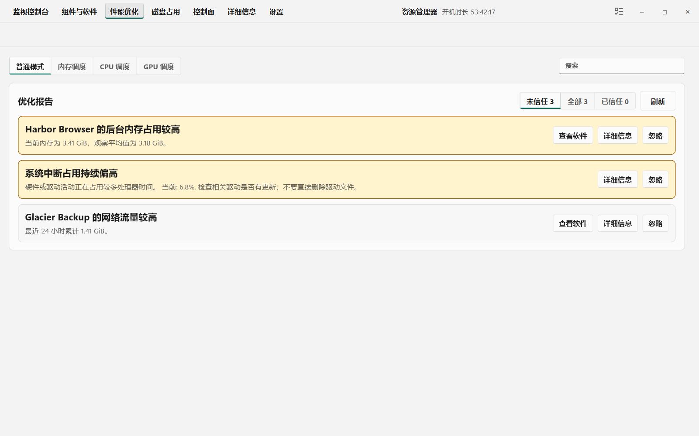
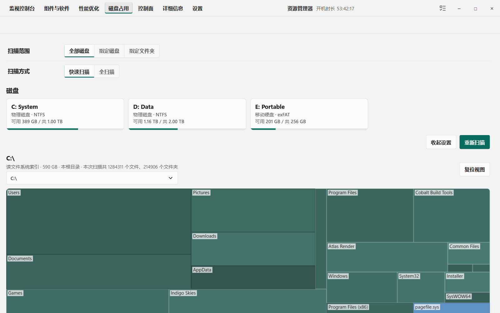
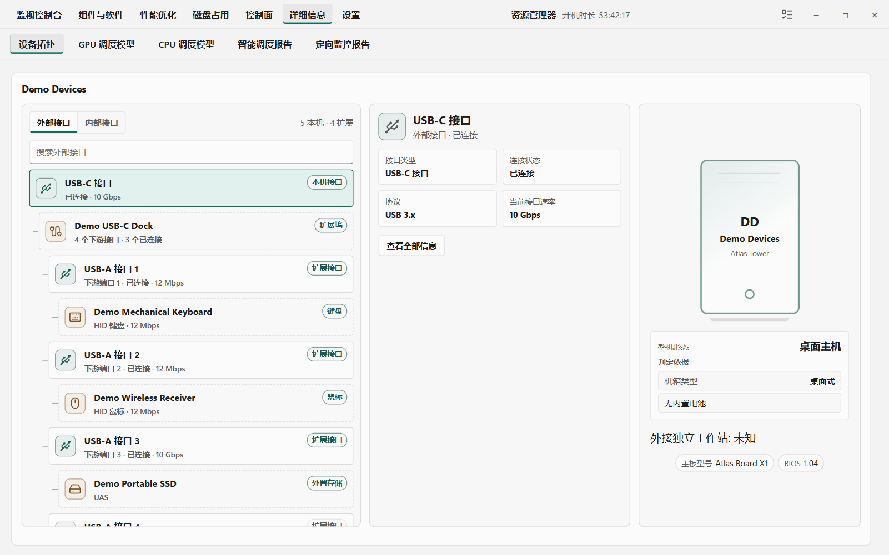
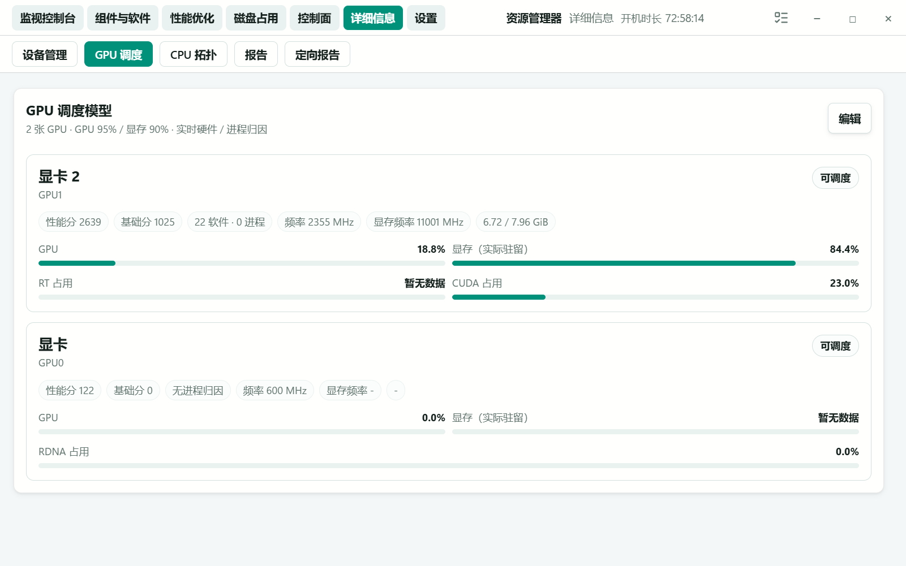

# 🖥️ 资源管理器 / Resource Manager

**看清电脑的每一份资源，并真正决定它们该给谁。**

[English](README.md) · **简体中文**

---

## 📖 这是什么

就像名字描述的那样，**资源管理器**是一个试图监视和管理电脑所有资源的软件：CPU 计算资源、GPU 计算资源、内存、显存，以及其他各种你能想到和没想到的资源。

从使用资源管理器开始，真正掌握你的电脑！🚀

> ⚠️ 硬件读数依赖于系统上可用的驱动与数据提供方；GPU 调度依赖软件和驱动的支持，并非每个运行中的程序都能切换显卡。

> 🌐 界面语言默认跟随系统，也可以在 设置 → 外观 → 界面语言 里手动指定。截图已脱敏：设备型号、外设名称、软件名称和个人路径使用通用名称代替。读数用于展示界面，不代表性能测试结果。

---

## 📊 监视控制台

帮助你监视电脑的各种数据。如图所示，所有常用的数据都在这里，你还可以自由调整排版以及监控的数据。

### 🧭 读数来源

同一个读数常常不止一个来源，比如核显温度既能从处理器的 SMU 读，也能从显卡驱动读。默认每个读数只显示这台电脑上最准确的来源；在 设置 → 外观 → 读数来源 里可以改为显示所有可用来源，最准确的会标为「首选」。调度判断始终使用最准确的来源，不受这个设置影响。

### 📈 条形图总览

上图下半部分使用条形图的方式帮助你快速判断电脑资源状态。除了常见的 CPU、GPU、内存、显存查看，你还可以查看**虚拟内存**。当然，这部分同样也有比图示更多的监控项供你自由配置。

### 🧮 类任务管理器视图

这部分是类似 Windows 系统任务管理器的页面，不过你可以在这里查看**更多的监控项**。布局和内容尽可能地复刻了任务管理器，你可以查看软件和进程的信息，并且拥有更低的性能占用和更高的流畅度。

而且它还解决了任务管理器的**共享内存重复计数**问题：条形图中黄色的部分是软件均摊的共享内存。不过这只是帮助你大概分析每个软件的情况 —— 没有人可能真正准确地划分共享内存的使用。

---

## 🧩 组件与软件

如图，这里你可以看到电脑上大部分的软件。如果是没有安装的软件，也可以指定主程序和根目录手动添加，以此将其纳入管理。

在这里你可以快速：

- 📍 查看软件位置
- ⚙️ 配置优化设置

每个软件可以设置基础分、允许调整的范围、启动 GPU 偏好和二级保护。运行 GPU 在进程进入调度后计算，不保存固定目标，启动偏好也不覆盖运行时计算。

读数和硬件控制用到的组件也在这里管理，例如硬件传感驱动（PawnIO）、AMD 处理器传感支持、风扇控制核心和硬件写入辅助进程。组件都需要你显式安装和验证，不会静默安装；没装的组件，对应读数显示为不可用，其他功能照常工作。

---

## ⚡ 性能优化

选择**普通模式**，或分别开启**内存调度**、**CPU 调度**和 **GPU 调度**。后三项可以任意组合；选择普通模式会清除其他选择。

- **🧠 内存调度** —— 管理内存压力，不会因此启用 CPU 或 GPU 动作。
- **⚙️ CPU 调度** —— 调整 CPU 策略与核心放置。
- **⚡ GPU 调度** —— 根据 GPU 负载和显存压力放置受支持的渲染进程。

**显存与内存压力。** GPU 调度会观察 GPU 负载和实际驻留显存。低优先级渲染进程只有具备已验证的运行时换卡路径时，才会请求移动到其他显卡，并在下一次驻留显存采样中检查效果。没有受支持路径的进程不会通过写入启动偏好或注入来假装完成运行时换卡；即使移动成功，来源显卡也可能保留部分占用。

**多显卡。** 可以为软件配置启动时使用的显卡。运行时移动只适用于通过兼容性和清理检查的渲染路径，不能保证任意使用 GPU 的软件都能移动。

**内存。** 选择内存调度后，系统会持续管理内存压力；它可以参考 CPU 分数决定内存动作的顺序，但不会因此执行 CPU 调度动作。

**CPU。** 选择 CPU 调度后，按软件评分做负载均衡：评分高的软件先挑更空闲、性能更强的核心，后来的软件避开已被占用的位置，而不是只看占用率。默认不限制 CPU 范围（全核心），只给线程设置首选核心，不缩小软件能用的核心；需要时可以把单个软件限制在单个 CCD。还可以配置**核心独占**和**核心锁定**，帮助维持稳定帧率。

> 💡 值得注意的是，本软件虽然使用了极其高性能的算法，但调度还是有性能损耗。CPU 多核性能过差的机器可能并没有明显的 CPU 效益提升（例如过早期的 i3、R5）。

> 🧪 运行时换卡采用不向目标注入 DLL 的外部控制路径。Chrome/ANGLE D3D11 路径已有部分显存释放的实测，但这不等于已验证原生 OpenGL 换卡；D3D12 和 Vulkan 仅在特定 Qt 测试程序上验证过。这不代表对所有软件通用：
> - 默认对游戏和专业软件不启用该功能；
> - 如果其余软件出现兼容性问题，请自行关闭对该软件的调度；
> - 部分主板或笔记本在独显直连时会关闭核显。只剩一张可用显卡时没有跨卡移动目标，但你仍可自行开启 GPU 调度。

### 📑 优化报告

通过监控记录来识别异常软件，或者偷走你电脑性能的软件 🕵️：

- 💽 异常写盘
- 🌐 异常频次的网络通信
- 📡 异常的网络流量
- 🧠 过高的内存占用
- 🔥 过高的 CPU 占用
- ⚡ 频繁造成 / 造成长系统中断
- …以及其他异常资源行为

它可以帮你抓出**内存泄漏**、**流氓软件**、**磁盘杀手**、**问题驱动**，以及持续在后台通信的可疑软件。

> 📌 异常的网络行为可以帮你找出值得进一步调查的软件，但资源管理器不会自动判定这些通信就是遥测，也不会推断传输内容的用途。

---

## 💽 磁盘占用

想知道空间都去哪了？扫描后，文件和文件夹按真实大小摆成**方格图**，越大的占得越多，一层层点进去就能找到占空间的东西。

可以扫全部磁盘、某一个磁盘，或某个文件夹。**快速扫描**直接读 NTFS 的文件系统索引，需要管理员权限；**全扫描**逐级遍历目录，慢一些，但任何磁盘都能扫。扫描只读文件信息，不会改动或删除任何文件。

---

## 🎛️ 硬件控制

把性能、功耗和噪声调到适合自己的平衡点。控制面集中展示当前硬件可用的 CPU、GPU 和风扇调节项，实时读数与调节控件放在一起，先看清现状，再决定怎么调。

每张设备卡片都有独立的**应用**和**撤销改动**。可以先修改多项设置，再只应用这一张卡；撤销时也不会丢掉其他卡片的草稿。常用设置可以存为配置，方便下次复用。不能调整的项目，把鼠标放到图标上即可查看原因；**普通**与 **Root** 两档权限区分日常调节和进阶控制。

硬件调整支持矩阵及依赖与硬件限制见[支持清单](#-支持清单)。

### 🌡️ 风扇曲线

按温度设定你想要的散热响应。拖动控制点或用键盘微调，相邻点之间采用**直线插值**，配合温度、转速百分比和横竖网格，调整时有清晰的参照。

硬件支持时，可以选择写入固件，或交给资源管理器在软件中执行。编辑只改变草稿，点击本卡应用后才下发；也可以把设备交还固件管理。可调项目、固件曲线档位和多风扇联动行为取决于硬件与驱动。

---

## 🔌 设备拓扑

如图所示，软件会显示该设备上（外部和内部的）所有接口及其信息，并显示连接的设备。

你可以快速查看**实际协商的协议** —— 很多情况下，这才是真正限制传输速度的东西。

---

## 🔬 详细信息

CPU 和 GPU 的详细监控信息，而不是只能看到一个简单的占用率数字，却没法找到真正的瓶颈。

**CPU 拓扑**：按 CCD、缓存层级和物理核心展示分核负载，以及每个逻辑处理器上占用最多的进程。

**GPU 调度**：每张显卡的性能分、占用、显存、频率，以及光栅之外的专用单元占用（NVIDIA 的 RT / CUDA / Tensor，AMD 的 GCN / RDNA / CDNA，取决于显卡与驱动是否提供该计数器）。

---

## 📋 支持清单

✅ **已验证支持** · 🟡 **已支持** · ❌ **未支持** · — 不适用

- **硬件调整：** ✅ 表示已有具体机型的调节与回读验证；🟡 表示设计支持，仍需完成接入或实机验证；❌ 表示设计不支持。
- **监控与设备信息：** ✅ 表示该读数已在实机上读到当前值。验证机为一台 AMD Ryzen 9 8940HX 笔记本，配 NVIDIA GeForce RTX 5060 Laptop GPU 和 AMD Radeon 610M 核显，没有 NPU，2026-10-22 只读检查；读数没有和其他工具对比。🟡 表示已实现，并用录制或模拟数据测试过，尚未在实机上确认；❌ 表示不支持。

本清单对应 2026-10-22 的源码。最新公开 beta 为 0.2.8（2026-10-01），下面很多读数是在它之后加入的，随下一个 beta 发布。实际能看到哪些读数，取决于硬件、驱动和已安装的组件；硬件不提供的读数显示为不可用。

### 硬件调整

矩阵按硬件调整的设计覆盖范围标注。当前发行版实际可用的调节项以控制页检测结果为准。

<table>
  <thead>
    <tr><th rowspan="2" scope="col">设备类型</th><th colspan="3" scope="colgroup">CPU</th><th colspan="3" scope="colgroup">GPU</th><th colspan="3" scope="colgroup">iGPU</th></tr>
    <tr><th align="center" scope="col">AMD</th><th align="center" scope="col">Intel</th><th align="center" scope="col">NVIDIA</th><th align="center" scope="col">AMD</th><th align="center" scope="col">Intel</th><th align="center" scope="col">NVIDIA</th><th align="center" scope="col">AMD</th><th align="center" scope="col">Intel</th><th align="center" scope="col">NVIDIA</th></tr>
  </thead>
  <tbody>
    <tr><th scope="row">💻 笔记本</th><td align="center" title="已支持">🟡</td><td align="center" title="已接入，待实机验证">🟡</td><td align="center" title="未支持">❌</td><td align="center" title="未支持：设计排除 AMD 笔记本独显">❌</td><td align="center" title="未支持：设计排除 Intel 独显">❌</td><td align="center" title="已支持">🟡</td><td align="center" title="已支持">🟡</td><td align="center" title="已支持">🟡</td><td align="center" title="未支持">❌</td></tr>
    <tr><th scope="row">🖥️ 桌面主机</th><td align="center" title="已支持">🟡</td><td align="center" title="已接入，待实机验证">🟡</td><td align="center" title="未支持">❌</td><td align="center" title="已接入，待实机验证">🟡</td><td align="center" title="未支持：设计排除 Intel 独显">❌</td><td align="center" title="已支持">🟡</td><td align="center" title="已支持">🟡</td><td align="center" title="已支持">🟡</td><td align="center" title="未支持">❌</td></tr>
  </tbody>
</table>

GPU 为独显，iGPU 为核显。

> 🔒 处理器、主板和内存的底层访问统一经过官方签名的 PawnIO 驱动，它兼容内存完整性和安全启动。资源管理器不使用 WinRing0、InpOut 这类有已知漏洞的驱动。

<strong>查看调节项、依赖与硬件限制</strong>

**调节范围与接入进度：**

**0.2.7 阶段发行版**已接通 **Intel CPU 和桌面 AMD 独显** 的控制页、组件安装、回读及恢复链路。桌面主板风扇使用 Fan Control Core 的 Super I/O 后端。新增链路已做接口测试，**尚未实机验证**。0.2.8 beta 没有改变调节范围。当前源码中，开关类调节项改为三选一：交还固件、开启、关闭。剩余设计缺口见下文。

- **AMD CPU / APU**：STAPM、慢速与快速功耗上限、PBO Scalar、CPU Curve Optimizer。需要 Hardware Bridge，具体型号、固件与驱动决定各项是否可用，Curve Optimizer 需要可回读；TDC / EDC 电流上限与温度上限的映射或回读尚未确认，当前未开放。
- **Intel CPU**：已实现 PL1 / PL2、各自时间窗及核心 / 缓存 / 核显 / 系统代理电压偏移，经官方签名 PawnIO IntelMSR 模块。组件需显式安装，固件锁定和 OC 邮箱拒绝会显示具体原因。**MMIO、TCC、Turbo 倍频 / 开关、HWP / EPP 和 CPU / 核显功率分配仍未完成**：当前签名模块不允许所需寄存器写入，安装现有组件也不能解锁这些项。
- **AMD 桌面独显**：已实现 ADLX 功耗偏移（%）、核心最低频率、显存最高频率。核心最高频率和电压在 Navi4 之前使用绝对值，已识别的 Navi4 使用偏移量，遵循 ADLX 的代际定义；未知代际的 GFX 项等待识别后开放。范围和步长由驱动提供，写入后回读；撤销逐参数恢复接管前的原值，不重置整块显卡。**旧式 GFX / VRAM 状态表接口尚未实现**。**AMD 笔记本独显明确不支持**，不进入通用 GPU 兜底写入器。
- **AMD 核显**：GPU Curve Optimizer，需要 Hardware Bridge 与相应 SMU 能力，独立于 CPU Curve Optimizer。
- **Intel 核显**：核心频率偏移，需要 IGCL 驱动接口与硬件开放调节能力。
- **NVIDIA 独显**：NVAPI 核心与显存频率偏移；NVML 功耗上限、核心与显存锁频、温度阈值。可调范围由驱动返回，部分笔记本驱动会拒绝 NVML 写入，能读取不代表能调整。
- **兼容的 Uniwill / 同方 OEM 笔记本**：另支持 cTGP 偏移、Dynamic Boost 开关与偏移，需要对应 EC 接口；寄存器回读不等于实际功耗变化。

**风扇调整：**

| 设备类型 | 状态 | 范围 |
| --- | --- | --- |
| 💻 笔记本 | 🟡 | 兼容的 OEM 通道：自动 / 全速、固件曲线、软件曲线与占空比；需要 Fan Control Core，各项分别检测 |
| 🖥️ 桌面主机 | 🟡 | Super I/O 主板接头由 Fan Control Core + LibreHardwareMonitorLib（PawnIO）接入；AMD ADLX 风扇控制器已接最低转速、目标 RPM 和 Zero RPM，逐能力探测。USB / HID、NVIDIA 原生风扇写入、AMD 固件风扇曲线仍未完成 |

仅有自动 / 全速接口的机器不提供任意定速；目标 RPM 与监测 RPM 分别显示。其他原设计缺口还包括 AMD CPU 电流 / 温度回读及命令校准、更多 SMU 调节项和 Linux 产品控制宿主；Fan Control Core 已有 Linux hwmon，不代表主产品已经支持 Linux。

当前尚未发布包含机型、驱动、调节值和回读结果的完整实机验证记录，因此没有将上述项目标为「✅ 已验证支持」。欢迎通过 Issues 提交这些信息及恢复默认值的结果，帮助补齐验证范围。

### 监控与读数

监视控制台最多可显示 325 个命名读数，按设备分组。下表按设备类型汇总，展开详情可查看每组读数及来源。

<table>
  <thead>
    <tr><th scope="col">设备类型</th><th align="center" scope="col">AMD</th><th align="center" scope="col">Intel</th><th align="center" scope="col">NVIDIA</th><th align="center" scope="col">Qualcomm</th></tr>
  </thead>
  <tbody>
    <tr><th scope="row">🧠 CPU</th><td align="center" title="已在 Ryzen 9 8940HX 上验证：Windows 计数器与 SMU 读数">✅</td><td align="center" title="已接入，待实机验证">🟡</td><td align="center" title="未支持：发行版只支持 Windows x64">❌</td><td align="center" title="未支持：发行版只支持 Windows x64">❌</td></tr>
    <tr><th scope="row">🎮 GPU</th><td align="center" title="与已验证的 Radeon 610M 走同一 ADLX 路径；独显尚未验证">🟡</td><td align="center" title="经 IGCL 接入，待实机验证">🟡</td><td align="center" title="已在 GeForce RTX 5060 Laptop GPU 上验证：NVML、NVAPI 与 Windows 计数器">✅</td><td align="center" title="不适用">—</td></tr>
    <tr><th scope="row">🖼️ iGPU</th><td align="center" title="已在 Radeon 610M 上验证：ADLX、SMU 与 Windows 计数器">✅</td><td align="center" title="经 IGCL 接入，待实机验证">🟡</td><td align="center" title="未支持：发行版只支持 Windows x64">❌</td><td align="center" title="未支持：发行版只支持 Windows x64">❌</td></tr>
    <tr><th scope="row">🤖 NPU</th><td align="center" title="已接入；验证机没有 NPU">🟡</td><td align="center" title="已接入；验证机没有 NPU">🟡</td><td align="center" title="不适用">—</td><td align="center" title="未支持：发行版只支持 Windows x64">❌</td></tr>
  </tbody>
</table>

✅ 表示该列的主要读数已在上述验证机上确认，其中个别读数仍可能是 🟡，见详情。AMD SMU 读数与处理器代际有关，目前只检查过 Ryzen 9 8940HX。

| 设备 | 状态 | 主要读数 | 来源 |
| --- | :---: | --- | --- |
| 🧮 内存与虚拟内存 | ✅ | 物理内存总量 / 已用 / 可用；提交量、上限与峰值；系统缓存；内核池；进程、线程与句柄数 | Windows，内置 |
| 🧩 NUMA 节点 | ✅ | 每个节点的可用内存与容量 | Windows，内置 |
| 💽 全部磁盘 | ✅ | 总活动时间、读写速率、队列长度 | Windows 性能计数器 |
| 💾 NVMe 硬盘 | 🟡 | 健康状态 ✅；NVMe 健康日志（温度、备用空间、磨损、读写数据量、错误、通电时间）、可靠性计数、单盘吞吐 / IOPS / 延迟 | Windows 存储接口 |
| 💾 SATA 硬盘 | 🟡 | 健康状态、ATA SMART 数据与阈值、可靠性计数、单盘吞吐 | Windows 存储接口 |
| 💾 USB 硬盘 | 🟡 | 健康状态 ✅；其他读数取决于 USB 桥接芯片 | Windows 存储接口 |
| 🌐 网络 | ✅ | 逐网卡 17 项累计计数与收发速率；总吞吐与利用率 | Windows IP Helper、性能计数器 |
| 🔋 电池 | ✅ | 电量、充放电功率、电源状态、设计 / 满充 / 剩余容量、电压、满充 / 设计容量比 | Windows 电池驱动 |
| 🌀 笔记本风扇 | ✅ | 兼容的 Uniwill / 同方笔记本的 CPU 与 GPU 风扇转速（RPM 与 %）；其他固件仍需按机型确认（🟡） | 内置 OEM 读取，只读 |
| 🌀 桌面风扇与主板传感器 | 🟡 | 风扇转速、主板 / VRM / 芯片组温度、主板电压、内存温度 | LibreHardwareMonitorLib 核心库 + 显式安装的 PawnIO |
| 📋 软件与进程 | ✅ | CPU、内存（含共享内存估算份额）、磁盘、网络、各 GPU 占用与显存 | Windows |

<strong>按设备查看读数、来源与限制</strong>

**CPU**

| 读数 | AMD | Intel | 来源 |
| --- | :---: | :---: | --- |
| 占用率；频率及相对基础频率的百分比 | ✅ | 🟡 | Windows 计数器，内置 |
| CPU 拓扑页的分核、分线程负载 | ✅ | 🟡 | Windows CPU Sets 与处理器信息 |
| 封装、STAPM、实际与平均功耗；SoC 功耗与电压；核心电压；封装、TDC 与 EDC 电流；SMU 温度；平均核心频率 | ✅ | — | AMD SMU，经 PawnIO 及其 RyzenSMU 模块（可选组件，需显式安装） |
| 核心与封装温度（DTS）、距 TjMax 余量、TjMax | — | 🟡 | Intel MSR，经 PawnIO 及其 IntelMSR 模块（可选组件） |
| 封装、核心、核显、DRAM 能量计数；封装与 DRAM 声明功耗限制 | — | 🟡 | Intel MSR |
| 逐线程有效频率（活动期间平均频率，来自 APERF / MPERF） | — | 🟡 | Intel MSR |
| 温度、功耗、电流与跨域限制状态（当前及已记录） | — | 🟡 | Intel MSR |
| CPU 温度与桌面 CPU 风扇 | 🟡 | 🟡 | CPU：原生 SMU / Intel DTS；桌面风扇：核心库 + PawnIO |

SMU 温度是 SMU 报告的值，尚未确定对应 Tctl 还是 Tdie。Intel C-state 驻留与详细降频原因暂不提供，因为当前签名 IntelMSR 模块不允许读取所需寄存器。Intel 区间功率暂未提供，提供的是原始能量计数。

**GPU**

| 读数 | NVIDIA | AMD | Intel | 来源 |
| --- | :---: | :---: | :---: | --- |
| 最忙引擎占用率 | ✅ | ✅ | 🟡 | Windows GPU 引擎计数器 |
| 逐引擎占用率 | 🟡 | 🟡 | 🟡 | Windows GPU 引擎计数器 |
| 厂商占用：处理器、显存控制器、编码器、解码器（NVML）；活动率（ADLX）；渲染 / 计算与媒体引擎忙碌率（IGCL） | ✅ | ✅ | 🟡 | NVML；ADLX；IGCL |
| 核心频率、显存频率、频率百分比 | ✅ | ✅ | 🟡 | NVML；ADLX 与 SMU；IGCL |
| 显存：已用、总量、空闲、保留 | ✅ | 🟡 | — | NVML；ADLX |
| 功耗与限制：报告、瞬时与 1 秒平均功耗，默认与生效上限（NVML）；芯片与整卡功耗（ADLX）；区间功率与能量（IGCL） | ✅ | 🟡 | 🟡 | NVML；ADLX；IGCL |
| 核心 / Edge / APU 温度 | ✅ | ✅ | 🟡 | NVML；ADLX 与 SMU；IGCL |
| 显存、热点与进风温度 | 🟡 | 🟡 | 🟡 | NVML；ADLX；IGCL |
| 电压 | ✅ | ✅ | 🟡 | NVAPI；ADLX 与 SMU；IGCL |
| 电流 | 🟡 | — | — | NVAPI |
| PCIe 链路代数与通道数（当前与最大） | ✅ | — | 🟡 | NVML；IGCL |
| 性能状态与时钟事件原因（NVML）；功耗 / 温度 / 电流 / 电压 / 占用限制标志（IGCL） | ✅ | — | 🟡 | NVML；IGCL |
| 显卡自报的风扇转速 | 🟡 | 🟡 | 🟡 | NVML（逐风扇）；ADLX；IGCL |
| 显存读写流量计数 | — | — | 🟡 | IGCL |

AMD 一列在 Radeon 610M 核显上检查；AMD 独显走同一 ADLX 路径，尚未检查。验证机的显卡不提供显存温度和电流。笔记本显卡风扇见笔记本风扇一行。

**NPU**

| 读数 | Intel | AMD | Qualcomm | 来源 |
| --- | :---: | :---: | :---: | --- |
| 名称、驱动与位置 | 🟡 | 🟡 | ❌ | DXCore、Windows 设备树 |
| 专用与共享内存的提交量和驻留量 | 🟡 | 🟡 | ❌ | DXCore |
| 引擎运行时间与忙碌率（任务管理器同款算法，可超过 100%） | 🟡 | 🟡 | ❌ | DXCore |
| AMD 报告的活动率与频率，显示在对应 AMD 显卡下 | — | 🟡 | — | ADLX |

验证机没有 NPU。Qualcomm NPU 运行在 Windows on Arm 上，x64 发行版不支持。

**内存、存储、网络、电池与风扇**

| 读数 | 状态 | 来源 |
| --- | :---: | --- |
| 物理内存、提交量、系统缓存、内核池；进程 / 线程 / 句柄数 | ✅ | Windows |
| NUMA 节点可用内存与容量（单节点） | ✅ | Windows |
| 多节点及纯内存 NUMA 节点 | 🟡 | Windows |
| 内存温度 | 🟡 | LibreHardwareMonitorLib Memory 组 + PawnIO |
| 全部磁盘的总活动时间、读写速率、队列长度 | ✅ | Windows 性能计数器 |
| 硬盘健康状态（NVMe 与 USB） | ✅ | Windows 存储管理（MSFT_PhysicalDisk） |
| 硬盘健康状态（SATA） | 🟡 | Windows 存储管理（MSFT_PhysicalDisk） |
| 硬盘温度、磨损、读写错误、通电时间、启停与加载次数、最大延迟 | 🟡 | Windows 存储可靠性计数 |
| NVMe 健康日志：警告、备用空间、已用百分比、综合温度与 8 个传感器温度、数据量、命令数、忙碌时间、上电次数、异常断电、介质错误、512 字节原始日志 | 🟡 | NVMe 健康日志查询 |
| ATA SMART 数据与阈值（原始页） | 🟡 | ATA SMART 查询 |
| 单盘读写速率、IOPS、活动时间、队列长度、延迟 | 🟡 | Windows 磁盘性能查询 |
| 逐网卡：字节、单播 / 组播 / 广播流量、包数、丢弃、错误、未知协议包、收发速率 | ✅ | Windows IP Helper |
| 网络总收发速率与利用率 | ✅ | Windows 性能计数器 |
| 电池电量、充放电功率、电源状态、各项容量、电压、满充 / 设计容量比 | ✅ | Windows 电池驱动 |
| 电池循环次数与剩余时间 | 🟡 | Windows 电池驱动，取决于电池固件 |
| 兼容的 Uniwill / 同方笔记本的 CPU / GPU 风扇转速 | ✅ | 内置 OEM 读取（UWACPI，只读） |
| 桌面风扇、主板 / VRM / 芯片组温度、主板电压 | 🟡 | LibreHardwareMonitorLib 核心库 + 显式安装的 PawnIO |
| 逐软件、逐进程的 CPU、内存、磁盘、网络、GPU 占用与显存 | ✅ | Windows 进程计数器、ETW、GPU 计数器 |

### 设备信息

| 范围 | 状态 | 内容 |
| --- | :---: | --- |
| 🔌 设备拓扑 | ✅ | 内部与外部接口、所接设备、实际协商与最高链路速率 |
| 🔗 USB、HID 与摄像头 | ✅ | USB 身份与速率、HID 集合、UVC 摄像头声明的帧间隔 |
| 🖥️ 显示器与 EDID 基础信息 | ✅ | 当前模式、HDR 状态、亮度、旋转；EDID 原文、版本、尺寸与色度 |
| 📐 显示模式与时序 | 🟡 | 从 EDID、CTA-861 和 DisplayID 1.3 / 2.x 解析的模式，含 Type V / VI 时序与 Adaptive-Sync |
| 🧠 CPU 身份与拓扑 | ✅ | CPUID 身份、指令集特性、核心、线程、CCD 与缓存 |
| 🎮 GPU 身份 | ✅ | 名称、PCI ID、驱动版本、VBIOS；NVIDIA CUDA 能力；AMD 显存类型 |
| 🧰 GPU API 能力 | 🟡 | Vulkan、OpenGL、Direct3D 与 OpenCL 的限制与特性 |
| 🧾 SMBIOS 与固件 | ✅ | 系统、主板、BIOS、内存条、插槽与 CPU 插座 |
| 💾 磁盘与卷 | ✅ | 分区布局、对齐、TRIM、卷空间、分页文件 |
| 🌐 网络、安全与驱动 | ✅ | 地址、路由、TCP / UDP 端点、安全软件、驱动版本 |
| 🤖 NPU 身份 | 🟡 | 名称、驱动与位置 |

<strong>查看设备信息详情与来源</strong>

| 范围 | 状态 | 内容 | 来源 |
| --- | :---: | --- | --- |
| 设备拓扑 | ✅ | USB、PCIe、HD Audio、eDP、HDMI、Mini DP、RJ45 与蓝牙接口及其后的设备，以及 USB-C 连接器管理（UCSI）；实际协商与最高速率 | Windows 设备树（SetupAPI / CfgMgr32） |
| USB | ✅ | VID / PID、类别、USB 版本、设备版本、序列号、连接器类型、上级集线器端口、当前与最高速率 | USB 集线器查询 |
| USB 摄像头（UVC） | ✅ | 各格式、各分辨率声明的帧间隔（Uncompressed / MJPEG）与最佳模式；当前视频流模式为 🟡 | USB 描述符 |
| HID | ✅ | 顶层集合、用途、报告长度、按钮与数值能力 | Windows HID 接口 |
| PCI | ✅ | 厂商 / 设备 / 子系统 / 修订 ID、硬件 ID 与兼容 ID、已分配的内存 / IO / 总线范围、中断；传统 DMA 通道为 🟡 | Windows 设备树 |
| 显示器 | ✅ | 当前模式的分辨率、精确刷新率比值与位深；HDR 支持 / 开启 / 生效；颜色模式、SDR 白电平、亮度、旋转 | DisplayConfig、DXGI |
| EDID 基础信息 | ✅ | Windows 保存的 EDID 原文、EDID 版本、产品名、物理尺寸、基础色度 | 注册表 EDID |
| 显示模式与时序 | 🟡 | 详细、标准与既定时序，CVT，范围限制；CTA-861 视频格式、YCbCr 4:2:0、颜色与 HDR 声明；DisplayID 1.3 时序（Type I、II、III、V、VI）与 DisplayID 2.x 时序（Type VII）、动态时序范围、Adaptive-Sync。遇到解析器不认识的声明时，模式列表显示为不可用，不做猜测 | 注册表 EDID |
| CPU | ✅ | CPUID 厂商 / 家族 / 型号 / 步进 / 品牌、指令集特性与系统可用特性；核心、线程、CCD、缓存、效率等级 | CPUID、Windows 处理器信息 |
| CPU 扩展信息 | 🟡 | XSAVE 状态掩码、地址宽度、虚拟化（VMX / SMX / SVM）、逐线程 CPUID 寄存器、封装与 die 关系、Intel 规格频率 | CPUID、Windows |
| GPU 身份 | ✅ | 名称、PCI ID、适配器 LUID、驱动版本；NVIDIA VBIOS 与 CUDA 计算能力；AMD VBIOS 版本、料号与日期、显存类型 | DXGI、NVML、ADLX |
| GPU API 能力 | 🟡 | Vulkan 核心与图像限制、OpenGL、Direct3D 11 视频、Direct3D 12 光追等级、OpenCL | 图形 API |
| NVIDIA 驱动配置 | 🟡 | 驱动 Profile 设置，只读 | NVAPI |
| SMBIOS | ✅ | 系统、主板与 BIOS；内存条（Type 17）、插槽（Type 9）、CPU 插座（Type 4） | 固件表 |
| ACPI 表 | 🟡 | ACPI 原始表，按需读取 | 固件表 |
| 磁盘与卷 | ✅ | 分区布局（MBR / GPT）、对齐、TRIM、总线类型、卷空间与配额、分页文件；ATA / NVMe Identify 数据为 🟡 | Windows 存储接口 |
| 网络配置 | ✅ | 网卡标识、IPv4 / IPv6 地址、路由、TCP / UDP 端点及所属进程 | Windows IP Helper |
| 安全软件 | ✅ | 防病毒与防火墙产品及其健康状态、生效的防火墙配置 | Windows 安全中心、防火墙接口 |
| 驱动 | ✅ | 每个设备的驱动提供商、日期与版本 | Windows 设备树 |
| 电池身份 | ✅ | 厂商、化学类型、序列号 | Windows 电池驱动 |
| NPU 身份 | 🟡 | 名称、驱动与位置 | DXCore、Windows 设备树 |

### 优化实机结果

2026-10-22 在上面的验证机（Ryzen 9 8940HX，2 个 CCD，32 GB 内存）上用开发版测过一次。测试期间同时有其他编译负载，整机可用内存的起伏来自这些负载，不能算作优化效果，所以下表只列直接观察到的动作和恢复结果。

| 项目 | 状态 | 实测 |
| --- | :---: | --- |
| 内存调度：修剪空闲后台进程 | ✅ | 12 分钟内修剪 8 个低占用后台进程，共约 430 MB；真正空闲的进程能保持在低位 |
| 内存调度：降低后台进程的内存优先级 | 🟡 | 切换到内存调度后 30 秒内写入 92 个进程，切回普通模式或停止后全部恢复；冷启动直接进入时执行偏少的问题已在源码修正，待复测 |
| CPU 调度：后台进程降优先级与节能（EcoQoS） | ✅ | 后台进程逐步降到空闲优先级并开启 EcoQoS；切回普通模式 5 秒内、正常停止后都与测试前一致 |
| CPU 调度：全核心评分均衡 | 🟡 | 30 秒内给 9 个进程的 270 个线程设置首选核心，两个 CCD 都有落点，没有改动任何进程的 CPU Sets 或亲和性；切回普通和停止后全部还原。刚进入时推进偏慢的问题已在源码修正，待复测 |
| CPU 调度：单 CCD 放置 | 🟡 | 在 2 个 CCD 的机器上会把进程放到单个 CCD；撤销放置失败的问题已在源码修复，待复测 |
| GPU 调度 | — | 未测，它涉及启动拦截和 D3D 代理 |

测试结束后，全部进程的优先级、亲和性、内存优先级、节流状态、CPU Sets 和线程首选核心都与测试前一致。

---

## ⚙️ 设置

配置你需要的调度策略。

外观可以选择界面风格和配色。风格改变控件的圆角、线条、阴影和字体，不改布局：标准（跟随系统、浅色、深色、低对比）、柔和（跟随系统、浅色、深色）、线框（跟随系统、纸面、石墨、蓝图）、终端（磷绿、琥珀、冰蓝）。每种风格只列出它自己的配色。

外观里还可以设置资源条动画帧率（默认跟随屏幕刷新率，也可以自定义 10–240 帧）和读数来源（默认只列最准确的来源，也可以显示全部并标出首选）。

---

## 🧑‍💻 开发者 API

高效的管理需要协作 🤝。

本地 API 与适配 SDK 可以让你把自己的监控与管理工具接入资源管理器。开发者 API 文档仍在整理中。

---

## ⬇️ 下载

从 GitHub Releases 获取 Windows x64 测试版：

**[👉 下载最新版本](https://github.com/BIOcanse/Resource-Manager/releases/latest)**

### 系统要求

- Windows 11 x64
- Microsoft Edge WebView2 运行时

发布包内已包含所需的 .NET 运行时。WebView2 使用系统自带的运行时；如果系统缺少 WebView2，程序会在首次启动时下载并安装微软官方运行时。检查和下载产品更新也需要联网，日常使用不依赖网络。

---

## 📦 安装

1. 下载最新的 Windows x64 发布包。
2. 将**整个文件夹**解压到临时位置。
3. 运行 `Install.exe`，阅读安装动作及其用途并同意。它会安装主程序和位于主程序根内 `Internal/Management` 的独立更新管理器，并注册服务、系统路径和开始菜单快捷方式；检测到本产品旧安装时，确认窗会列出停止旧版、移除旧版启动及系统登记、复制用户数据和登记新安装的动作；旧程序和原始数据保留。
4. 从开始菜单搜索 **Resource Manager**，或运行已安装的 `Start.exe` 启动服务与桌面界面。可自行将开始菜单入口固定到任务栏。
5. 需要更新、恢复中断更新或修复主程序时，从开始菜单打开 **Resource Manager 更新管理**。手动更新和修复需要选择已解压的完整发行包；管理器会先显示操作内容，再请求管理员权限。
服务管理会请求管理员权限，界面本身以普通用户身份运行。

`Install.exe` 只负责安装或重新安装，`Start.exe` 只负责启动。重装会复制 `Config`、`UserData`、`Misc` 到新根；默认根被旧文件占用时使用带版本号的新根，旧维护文件保留在旧根，旧外置入口归入该根的 `Internal` 中。独立更新管理器安装在主程序根的 `Internal/Management` 中，提供原目录更新和同版本修复。自动更新开关目前只保存偏好；正式启用仍取决于发布签名和真实机器升级验收。

使用 `UninstallResourceManager.exe` 卸载。选择保留用户数据后，原安装目录只留下一个可导入 ZIP，并打开该目录的文件资源管理器窗口。独立更新管理器提供 ZIP 导入；在留存目录重新安装时，压缩包保存在 `UserData/Archives`，由用户选择何时导入。

---

## 📄 许可与致谢

资源管理器基于 **[Apache License 2.0](LICENSE)** 授权，第三方组件仍适用各自的许可证。

没有 Microsoft、.NET Foundation 以及众多上游作者与维护者的工作，就没有这个项目，在此深表感谢 🙏。完整的致谢与许可信息见应用内的「致谢」页面，以及 [第三方声明](src/Core/ThirdPartyNotices/README.md)。

---

## 🗂️ 仓库

本项目由作者本人维护，**暂不接受外部贡献与 Pull Request**。

https://github.com/BIOcanse/Resource-Manager
