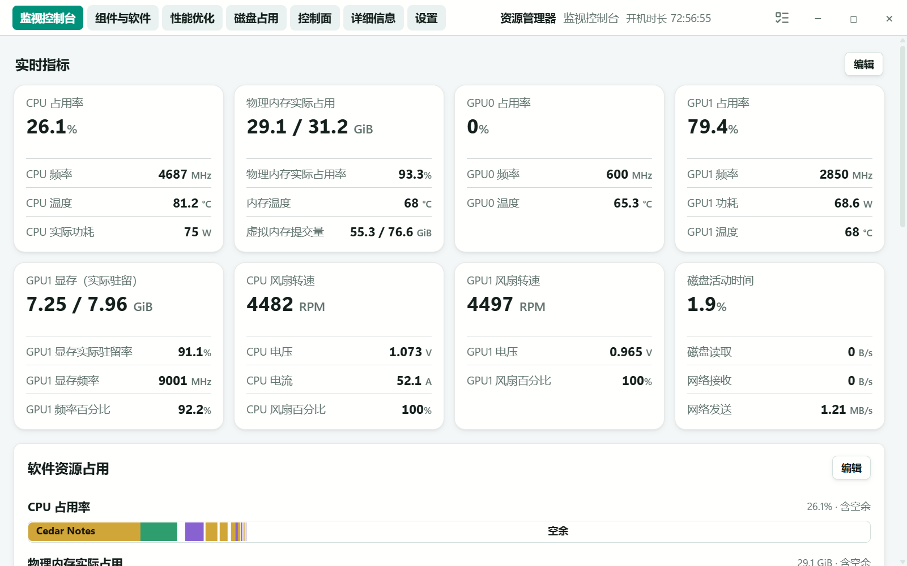
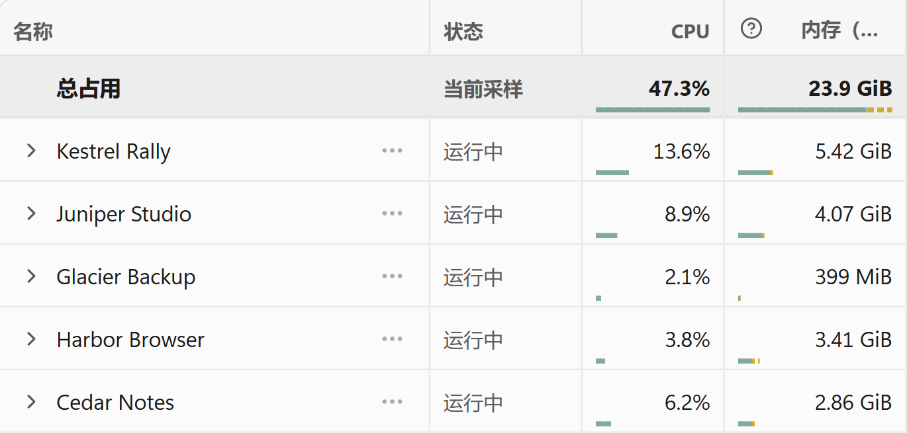
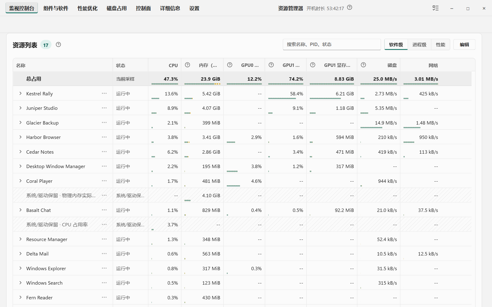
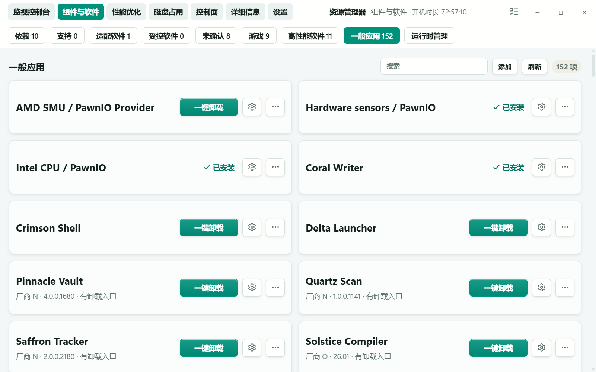
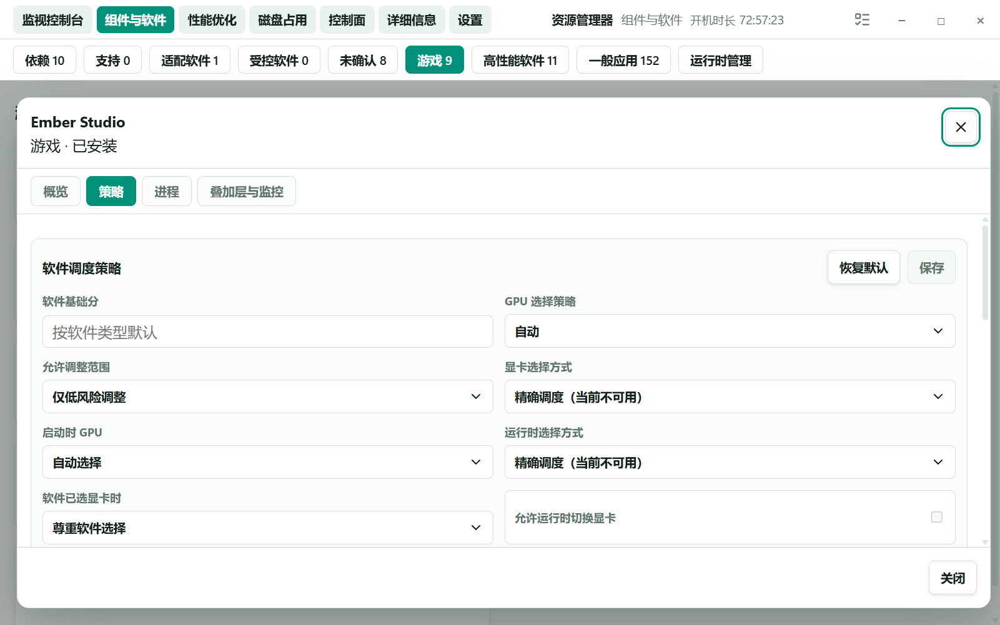
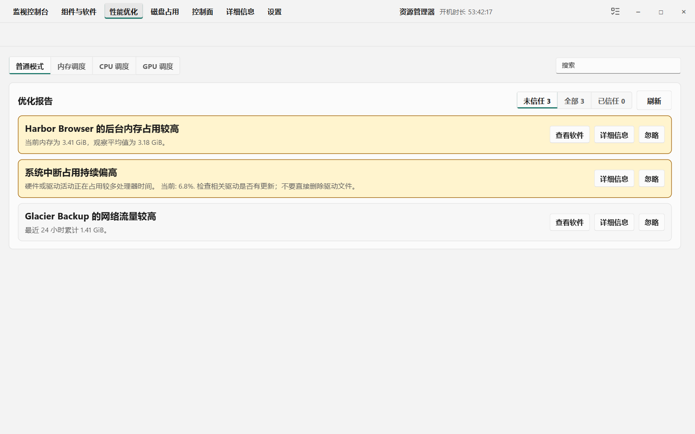
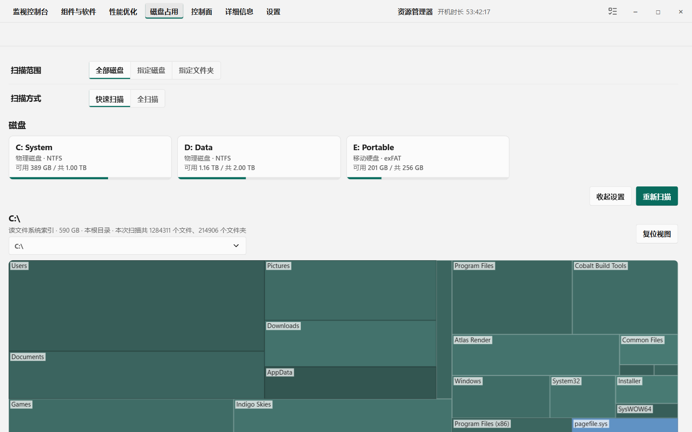
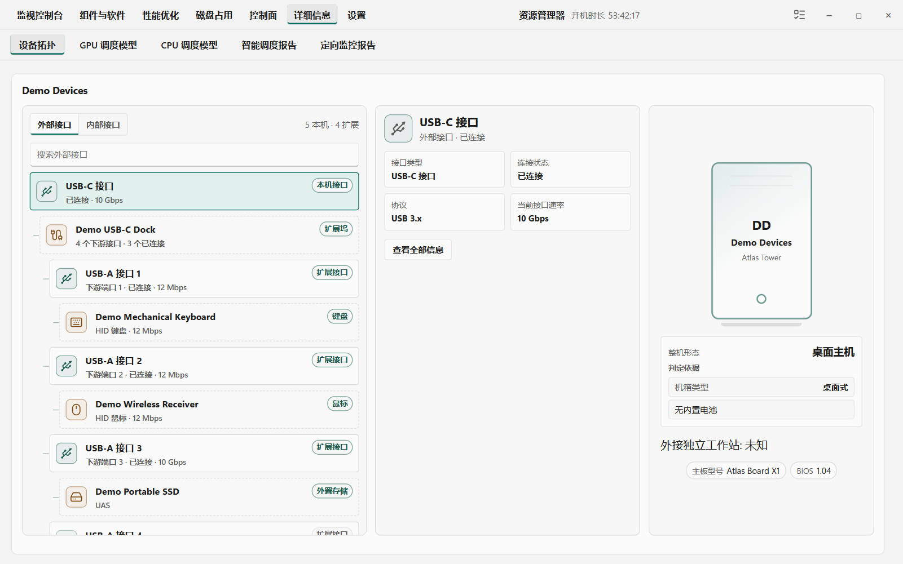
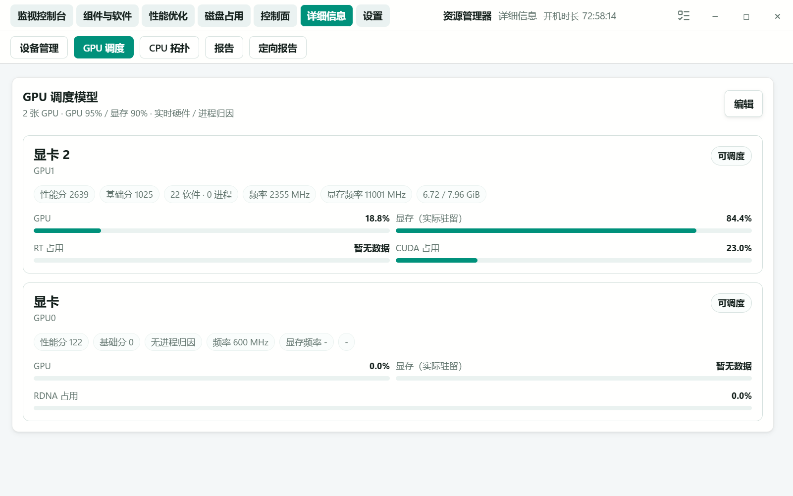

# 🖥️ 资源管理器

**看清电脑里的每一份资源，由你决定给谁用。**

[English](README.md) · **简体中文**

---

## 📖 简介

资源管理器帮你看清电脑的处理器、显卡、内存、显存、磁盘和网络都用在了哪里，并由你决定哪些程序优先。

永久免费，开放源代码。

> ⚠️ 能看到和能调整的内容取决于你的硬件和驱动。硬件不提供的读数会显示为不可用。

> 🖼️ 截图中的机器和数据均为虚构。

---

## 📊 监控

控制台把你关心的读数放在卡片和资源条上。每张卡片显示什么、怎么排布，都由你决定。

很多读数有不止一个来源。可以手动指定，也可以保持「自动」，使用本机最准确的来源。

资源条让你一眼看清占用情况，也包括虚拟内存。暂时没有读数的资源条会说明原因。

### 🧮 进程

用法和任务管理器相同，但可以看的列更多，开销更低。

共享内存不会被重复计算。每条内存条后面的虚线部分，是这个程序估算分摊到的共享内存。

系统和驱动自留的内存单独成行，并拆分出各个组成部分。

---

## 🧩 软件

列出电脑上的程序和它们的安装位置。不是常规方式安装的程序，可以手动添加。

每个程序都有自己的策略：基础评分、允许的调整、启动时优先使用的显卡和保护级别。

传感器驱动等可选组件，只在你要求时才安装。没有安装时，相关读数显示为不可用，其他功能照常使用。

---

## ⚡ 优化

**内存**、**处理器**、**显卡**三种调度可以分别开启，任意组合。选择**普通**则全部关闭。

- **🧠 内存调度**：缓解内存压力。
- **⚙️ 处理器调度**：评分高的程序优先使用更快、更空闲的核心。除非你主动设置，不会禁止任何程序使用任何核心。
- **⚡ 显卡调度**：关注显卡负载和显存，可以把后台程序从独立显卡移到核芯显卡。

只有支持切换的程序才能在运行中换到另一块显卡。游戏和专业软件默认不参与。

> 💡 调度本身也有少量开销。核心少、性能弱的处理器上，收益可能不明显。

### 📑 报告

资源管理器会留意表现异常的程序：

- 💽 异常的磁盘写入
- 🌐 频繁或大量的网络通信
- 🧠 内存占用过高或泄漏
- 🔥 处理器占用过高
- ⚡ 时间过长或过于频繁的系统中断

异常的网络通信只是值得留意的线索，不代表程序一定有问题。

---

## 💽 磁盘占用

看看磁盘被什么占满了。文件和文件夹按实际占用的大小画成方块，点开方块可以逐层深入。

可以扫描全部磁盘、单个磁盘或一个文件夹。**快速扫描**需要管理员权限，**完整扫描**任何磁盘都能用。扫描只读取，不会修改或删除任何文件。

---

## 🎛️ 硬件调节

在一处平衡性能、功耗和噪音。每个调节项旁边都有实时读数。

每张设备卡片都有自己的**应用**和**撤销**。常用设置可以存为配置，下次直接使用。暂时不能调节的项目会说明原因。

你的硬件能调哪些，见[硬件支持](#-硬件支持)。

### 🌡️ 风扇曲线

拖动曲线上的点，设定每个温度下的风扇转速。

视硬件而定，风扇可以交给固件管理，可以把你的曲线写入固件，也可以在资源管理器运行时由它直接控制。

---

## 🔌 设备拓扑

查看电脑内外的每一个接口，以及接在上面的设备。

这里显示的是连接实际协商出的速率，它往往才是真正的瓶颈。

---

## 🔬 详细信息

**处理器拓扑**：每个核心、每个线程的负载，以及正在使用它们的程序。

**显卡**：每块显卡的负载、显存、频率和专用单元占用。

**录制**：记录一个正在运行的程序的帧时间和资源占用，可以导出为 JSON 或 CSV。

---

## ⚙️ 设置

调度方式、外观、更新方式和访问密钥都在这里设置。

- **外观**：多种风格和配色，浅色和深色主题，三种动效风格。
- **更新**：关闭、只提醒，或自动下载并安装。
- **访问密钥**：允许本机的其他程序使用资源管理器，权限由你授予，随时可以撤销。

---

## 🧑‍💻 开发者接口

本机程序可以通过本地接口和适配开发包读取数据、请求操作。每个程序都需要经你批准的访问密钥。

---

## 📋 硬件支持

✅ 已在真机上测试 · 🟡 已实现，尚未在真机上测试 · ❌ 不支持 · — 不适用

### 调节

<table>
  <thead>
    <tr><th rowspan="2" scope="col">设备</th><th colspan="3" scope="colgroup">处理器</th><th colspan="3" scope="colgroup">独立显卡</th><th colspan="3" scope="colgroup">核芯显卡</th></tr>
    <tr><th scope="col">AMD</th><th scope="col">英特尔</th><th scope="col">英伟达</th><th scope="col">AMD</th><th scope="col">英特尔</th><th scope="col">英伟达</th><th scope="col">AMD</th><th scope="col">英特尔</th><th scope="col">英伟达</th></tr>
  </thead>
  <tbody>
    <tr><th scope="row">💻 笔记本</th><td align="center">🟡</td><td align="center">🟡</td><td align="center">❌</td><td align="center">❌</td><td align="center">❌</td><td align="center">🟡</td><td align="center">🟡</td><td align="center">🟡</td><td align="center">❌</td></tr>
    <tr><th scope="row">🖥️ 台式机</th><td align="center">🟡</td><td align="center">🟡</td><td align="center">❌</td><td align="center">🟡</td><td align="center">❌</td><td align="center">🟡</td><td align="center">🟡</td><td align="center">🟡</td><td align="center">❌</td></tr>
  </tbody>
</table>

- **AMD 处理器**：功耗上限、PBO 倍率、曲线优化器。
- **英特尔处理器**：PL1 / PL2 及其时间窗、电压偏移。
- **AMD 独立显卡**：在驱动允许的范围内调节功耗、核心频率、显存频率和电压。
- **AMD 核芯显卡**：曲线优化器。
- **英特尔核芯显卡**：核心频率偏移。
- **英伟达显卡**：频率偏移、功耗上限、锁定频率、温度上限。部分笔记本驱动不允许修改。
- **兼容的同方模具笔记本**：显卡功耗偏移和动态加速。

> 🔒 底层访问使用经过签名的驱动，兼容内存完整性和安全启动。不使用任何有已知漏洞的驱动。

### 风扇

| 设备 | 状态 | 可以做什么 |
| --- | :---: | --- |
| 💻 笔记本 | 🟡 | 兼容机型上的自动或全速、固件曲线、软件曲线 |
| 🖥️ 台式机 | 🟡 | 主板风扇接口；AMD 显卡的最低转速和目标转速 |

### 监控

| 设备 | 状态 | 可以看到 |
| --- | :---: | --- |
| 🧠 处理器 | ✅ AMD · 🟡 英特尔 | 每个核心和线程的负载、频率、功耗、电压、温度 |
| 🎮 独立显卡 | 🟡 | 负载、显存、频率、功耗、温度、风扇 |
| 🖼️ 核芯显卡 | ✅ AMD · 🟡 英特尔 | 负载、共享显存、频率、功耗、温度 |
| 🤖 神经网络处理器 | 🟡 | 负载和内存 |
| 🧮 内存 | ✅ | 物理内存、虚拟内存、缓存、内核池 |
| 💽 磁盘 | ✅ | 活动时间、读写速度、队列 |
| 💾 固态硬盘和机械硬盘 | 🟡 | 健康状况、温度、磨损、写入量 |
| 🌐 网络 | ✅ | 每块网卡的速度和流量 |
| 🔋 电池 | ✅ | 电量、充放电速率、容量、损耗 |
| 🌀 台式机风扇和传感器 | 🟡 | 风扇转速、主板温度和电压 |
| 📋 程序 | ✅ | 每个程序的处理器、内存、磁盘、网络和显卡占用 |

### 设备信息

| 类别 | 状态 | 可以看到 |
| --- | :---: | --- |
| 🔌 接口和连接的设备 | ✅ | 每个接口、接了什么、协商速率 |
| 🔗 USB、HID 设备和摄像头 | ✅ | 设备标识和速率、摄像头支持的模式 |
| 🖥️ 显示器 | ✅ | 当前模式、HDR、刷新率、EDID |
| 🧠 处理器和显卡 | ✅ | 型号、特性、核心、缓存、驱动 |
| 🧾 主板和固件 | ✅ | 系统、主板、BIOS、内存条 |
| 💽 磁盘和分区 | ✅ | 分区、空间、TRIM |
| 🌐 网络和安全 | ✅ | 地址、各程序的连接、杀毒软件和防火墙 |

---

## ⬇️ 下载

**[👉 下载最新版本](https://github.com/BIOcanse/Resource-Manager/releases/latest)**

### 系统要求

- Windows 11 64 位
- 微软 WebView2 运行时。如果没有安装，资源管理器首次启动时会询问是否安装。

---

## 📦 安装

1. 下载发行包，解压整个文件夹。
2. 运行 `Install.exe`。它会先列出要做的操作，经你同意后才开始。
3. 从开始菜单打开**资源管理器**。

需要更新或修复时，从开始菜单打开更新管理器。

卸载请运行 `UninstallResourceManager.exe`。可以把你的数据保留为一个文件，之后再导入。

---

## 📄 许可证

资源管理器基于 [Apache 2.0 许可证](LICENSE)发布。第三方组件适用各自的许可证，完整列表见软件内的「致谢」页。

感谢它所依赖的各个开源项目的作者 🙏。

---

## 🗂️ 仓库

本项目由作者维护，不接受拉取请求。
